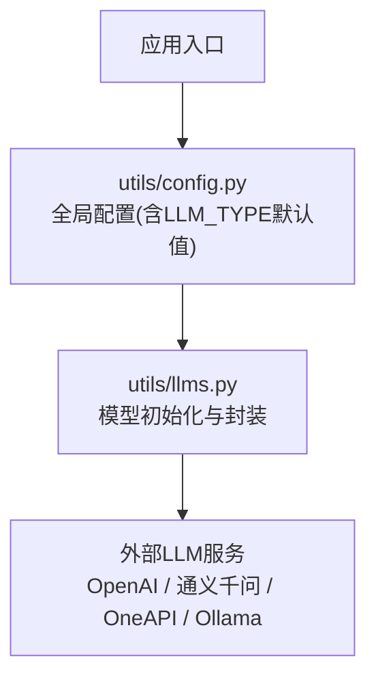
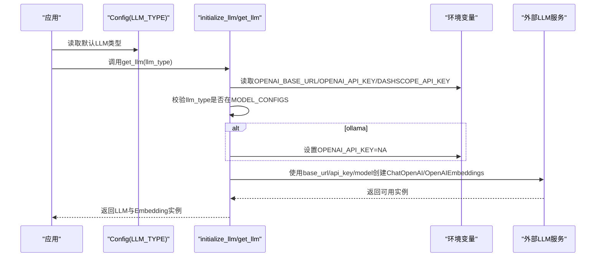
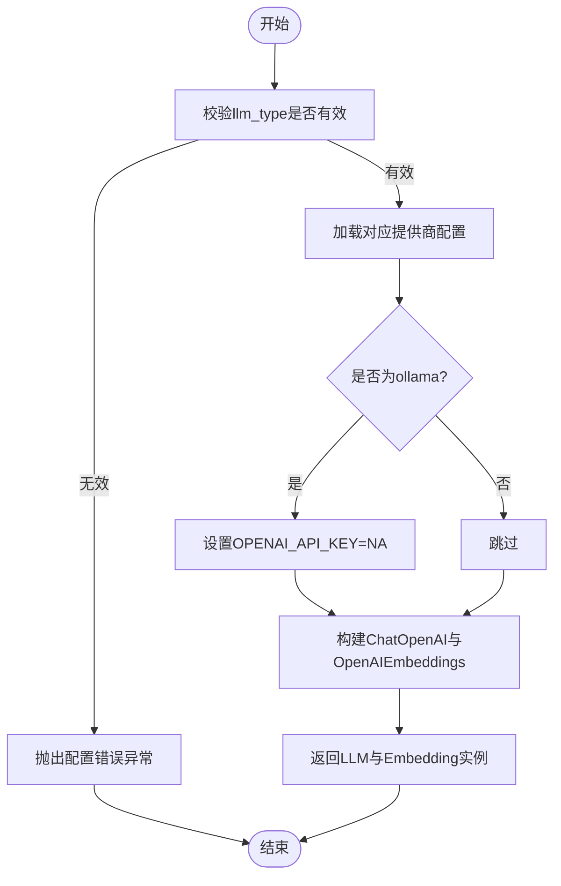
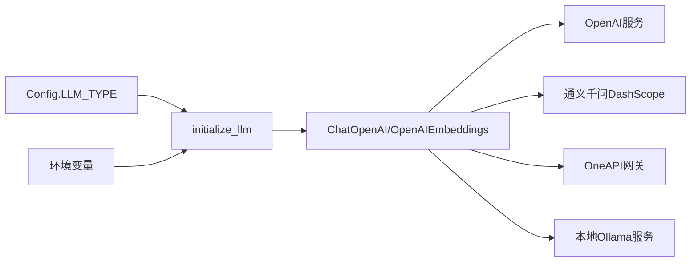

# LLM服务配置

<cite>
**本文引用的文件**
- [utils/config.py](file://utils/config.py)
- [utils/llms.py](file://utils/llms.py)
- [README.md](file://README.md)
</cite>

## 目录
1. [简介](#简介)
2. [项目结构](#项目结构)
3. [核心组件](#核心组件)
4. [架构总览](#架构总览)
5. [详细组件分析](#详细组件分析)
6. [依赖关系分析](#依赖关系分析)
7. [性能与限制](#性能与限制)
8. [故障排查指南](#故障排查指南)
9. [结论](#结论)
10. [附录：配置示例与最佳实践](#附录配置示例与最佳实践)

## 简介
本文件面向开发者，系统化说明本项目中“大模型服务配置”的设计与使用方法。内容涵盖：
- 支持的模型提供商与切换方式（openai、qwen、oneapi、ollama）
- 认证配置、API密钥管理、请求限制等关键参数
- 多模型支持的设计与扩展方法
- 各LLM服务的配置示例与最佳实践
- 模型选择策略与成本控制建议

目标是帮助开发者正确配置和管理各种大模型服务，确保稳定、可维护、可扩展地接入不同厂商或本地推理服务。

## 项目结构
与LLM配置直接相关的代码集中在 utils 目录下：
- utils/config.py：集中定义系统常量与默认配置，包括 LLM_TYPE 的默认值与服务地址端口等
- utils/llms.py：实现多模型初始化、统一封装、错误处理与日志记录
- README.md：提供项目背景、功能概览与环境准备说明

图表来源
- [utils/config.py:4-33](file://utils/config.py#L4-L33)
- [utils/llms.py:31-112](file://utils/llms.py#L31-L112)

章节来源
- [utils/config.py:4-33](file://utils/config.py#L4-L33)
- [utils/llms.py:31-112](file://utils/llms.py#L31-L112)
- [README.md:55-70](file://README.md#L55-L70)

## 核心组件
- 统一配置类 Config：集中管理数据库、缓存、任务队列以及 LLM_TYPE 等全局常量
- 模型配置字典 MODEL_CONFIGS：按提供商维度组织 base_url、api_key、chat_model、embedding_model
- 初始化函数 initialize_llm：根据 llm_type 创建 ChatOpenAI 与 OpenAIEmbeddings 实例，并设置超时与重试
- 获取函数 get_llm：对外暴露的统一入口，具备失败回退到默认配置的容错能力
- 自定义异常 LLMInitializationError：用于捕获并上报初始化阶段的错误

章节来源
- [utils/config.py:4-33](file://utils/config.py#L4-L33)
- [utils/llms.py:31-119](file://utils/llms.py#L31-L119)

## 架构总览
下图展示了从配置到初始化的整体流程，以及不同提供商的配置差异与统一抽象。

图表来源
- [utils/config.py:28-29](file://utils/config.py#L28-L29)
- [utils/llms.py:31-112](file://utils/llms.py#L31-L112)

## 详细组件分析

### 配置中心（Config）
- 职责：集中管理全局常量，避免散落的魔法值；提供 LLM_TYPE 的默认值
- 关键点：
  - LLM_TYPE 默认值为 qwen，可通过修改该常量切换默认模型提供商
  - HOST/PORT 为API服务监听地址与端口，便于前后端联调
  - DB_URI、Redis、Celery 等配置与LLM无关但影响整体运行环境

章节来源
- [utils/config.py:4-33](file://utils/config.py#L4-L33)

### 模型初始化与封装（llms.py）
- 模型配置字典 MODEL_CONFIGS：
  - openai：通过环境变量 OPENAI_BASE_URL、OPENAI_API_KEY 注入；默认 chat_model 为 gpt-4o-mini，embedding_model 为 text-embedding-3-small
  - oneapi：内置 base_url、api_key、chat_model、embedding_model（注意：生产环境建议将敏感信息移至环境变量）
  - qwen：base_url 指向通义兼容模式，api_key 通过 DASHSCOPE_API_KEY 注入；chat_model 为 qwen-max，embedding_model 为 text-embedding-v1
  - ollama：本地推理服务，base_url 指向 localhost:11434/v1；特殊处理 OPENAI_API_KEY=NA 以适配底层SDK
- 初始化逻辑 initialize_llm：
  - 校验 llm_type 是否受支持
  - 针对 ollama 进行环境变量特殊处理
  - 使用统一的 ChatOpenAI/OpenAIEmbeddings 构造器，设置 model、base_url、api_key、temperature、timeout、max_retries
- 获取接口 get_llm：
  - 若指定类型初始化失败，自动回退到默认类型（DEFAULT_LLM_TYPE）
  - 若默认类型也失败，抛出异常以便上层处理

图表来源
- [utils/llms.py:70-119](file://utils/llms.py#L70-L119)

章节来源
- [utils/llms.py:31-119](file://utils/llms.py#L31-L119)

### 数据模型（models.py）
- 负责定义Agent请求/响应、会话状态等数据结构，与LLM配置无直接耦合
- 在后续业务层通过统一接口消费LLM能力时，会结合这些模型进行序列化与校验

章节来源
- [utils/models.py:1-97](file://utils/models.py#L1-L97)

## 依赖关系分析
- 配置依赖：
  - 环境变量：OPENAI_BASE_URL、OPENAI_API_KEY、DASHSCOPE_API_KEY
  - 配置文件：Config.LLM_TYPE 决定默认提供商
- 运行时依赖：
  - 外部服务：OpenAI API、通义千问 DashScope、OneAPI 网关、本地 Ollama 服务
  - SDK：langchain-openai 提供的 ChatOpenAI 与 OpenAIEmbeddings
- 耦合点：
  - 所有提供商均通过统一的 base_url/api_key/model 三要素接入，降低耦合度
  - ollama 需要特殊的环境变量处理，属于唯一例外分支

图表来源
- [utils/config.py:28-29](file://utils/config.py#L28-L29)
- [utils/llms.py:31-112](file://utils/llms.py#L31-L112)

章节来源
- [utils/config.py:28-29](file://utils/config.py#L28-L29)
- [utils/llms.py:31-112](file://utils/llms.py#L31-L112)

## 性能与限制
- 超时与重试：
  - 初始化时设置了 timeout=30（秒）与 max_retries=2，有助于缓解网络抖动与临时不可用
- 并发与资源：
  - 建议在部署侧配合连接池与限流策略，避免对上游服务造成压力
- 成本与配额：
  - 不同提供商的计费与配额策略不同，建议在生产环境开启用量监控与告警
- 本地模型：
  - ollama 适合低成本实验与离线场景，但需关注显存与推理延迟

[本节为通用指导，不直接分析具体文件]

## 故障排查指南
- 常见错误与定位：
  - 不支持的 llm_type：检查传入值是否在 MODEL_CONFIGS 中
  - 缺少环境变量：确认 OPENAI_BASE_URL、OPENAI_API_KEY、DASHSCOPE_API_KEY 已正确设置
  - 网络连通性：验证 base_url 可达（如 Ollama 默认 http://localhost:11434/v1）
  - 认证失败：核对 api_key 是否正确且未过期
- 日志与调试：
  - 模块内已配置日志处理器，输出包含时间、级别、消息，便于定位问题
  - 初始化失败时会记录错误日志并抛出 LLMInitializationError，可在上层捕获并降级

章节来源
- [utils/llms.py:8-28](file://utils/llms.py#L8-L28)
- [utils/llms.py:83-119](file://utils/llms.py#L83-L119)

## 结论
本项目通过统一的配置与初始化层，屏蔽了不同LLM提供商的差异，实现了“一处配置、多处接入”。借助环境变量与默认回退机制，既保证了灵活性，又提升了鲁棒性。建议在生产环境中：
- 将敏感信息（API Key）放入环境变量或密钥管理服务
- 明确各提供商的限额与成本模型，建立监控与熔断策略
- 根据业务需求选择合适的模型与温度参数，平衡质量与成本

[本节为总结性内容，不直接分析具体文件]

## 附录：配置示例与最佳实践

### 支持的模型提供商与切换方法
- 支持的提供商：openai、qwen、oneapi、ollama
- 切换方法：
  - 修改 Config.LLM_TYPE 的默认值，或通过 get_llm(llm_type) 指定类型
  - 对于 ollama，需在本地启动 Ollama 服务并确保 base_url 可达

章节来源
- [utils/config.py:28-29](file://utils/config.py#L28-L29)
- [utils/llms.py:70-112](file://utils/llms.py#L70-L112)

### 认证配置与API密钥管理
- openai：
  - 环境变量：OPENAI_BASE_URL、OPENAI_API_KEY
- qwen（通义千问）：
  - 环境变量：DASHSCOPE_API_KEY
- oneapi：
  - 当前代码中硬编码了 base_url 与 api_key，建议迁移至环境变量或密钥管理系统
- ollama：
  - 无需真实API Key，内部会设置 OPENAI_API_KEY=NA 以适配SDK

章节来源
- [utils/llms.py:31-57](file://utils/llms.py#L31-L57)
- [utils/llms.py:90-93](file://utils/llms.py#L90-L93)

### 请求限制与稳定性
- 超时与重试：
  - 初始化时设置 timeout=30、max_retries=2，提升抗抖能力
- 建议：
  - 在网关或客户端层增加重试与退避策略
  - 对高频调用实施限流与熔断

章节来源
- [utils/llms.py:95-102](file://utils/llms.py#L95-L102)

### 多模型支持与扩展方法
- 扩展新提供商：
  - 在 MODEL_CONFIGS 中添加新的键值对，包含 base_url、api_key、chat_model、embedding_model
  - 如有特殊处理（如 ollama），在 initialize_llm 中补充分支逻辑
  - 如需新增环境变量，同步更新文档与部署脚本
- 设计要点：
  - 保持三要素（base_url、api_key、model）一致，便于统一封装
  - 将敏感信息与业务逻辑解耦，优先使用环境变量

章节来源
- [utils/llms.py:31-57](file://utils/llms.py#L31-L57)
- [utils/llms.py:83-112](file://utils/llms.py#L83-L112)

### 各LLM服务配置示例（路径指引）
- openai：参考 MODEL_CONFIGS 中的 openai 条目，设置 OPENAI_BASE_URL 与 OPENAI_API_KEY
- qwen：参考 MODEL_CONFIGS 中的 qwen 条目，设置 DASHSCOPE_API_KEY
- oneapi：参考 MODEL_CONFIGS 中的 oneapi 条目，建议将 api_key 迁移至环境变量
- ollama：确保本地 Ollama 服务运行于 http://localhost:11434/v1

章节来源
- [utils/llms.py:31-57](file://utils/llms.py#L31-L57)

### 模型选择策略与成本控制建议
- 选择策略：
  - 对话质量要求高：优先选择高质量模型（如 qwen-max、gpt-4o-mini 等）
  - 成本敏感：选择性价比更高的轻量模型或本地模型（如 ollama）
  - 低延迟：评估本地模型与边缘部署方案
- 成本控制：
  - 合理设置 temperature 与最大token数
  - 启用缓存与复用（如向量检索）减少重复计算
  - 监控用量与费用，设置阈值告警

[本节为通用指导，不直接分析具体文件]