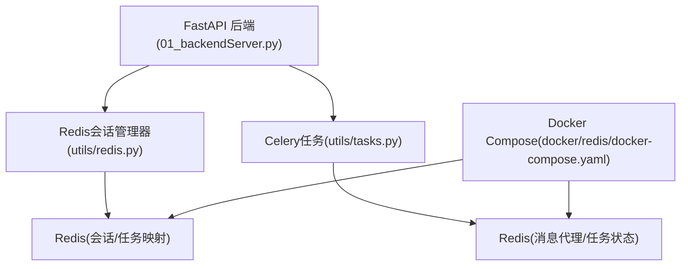
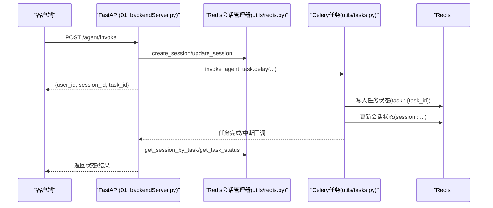
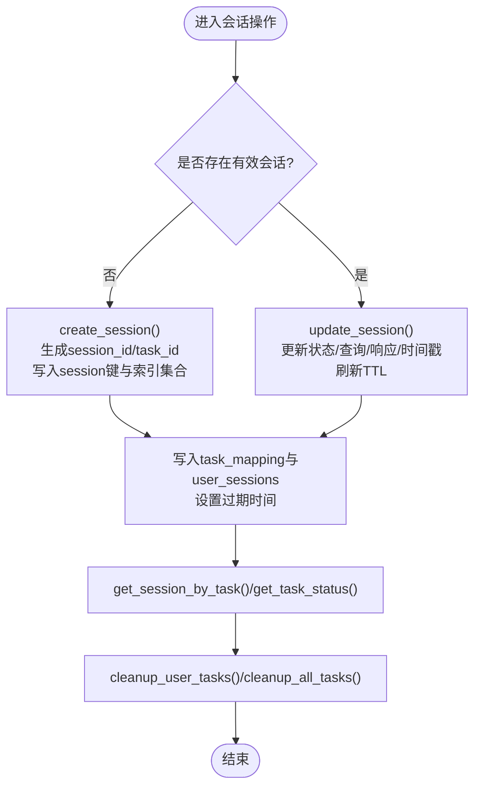
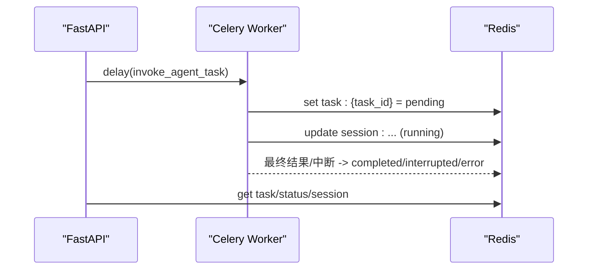
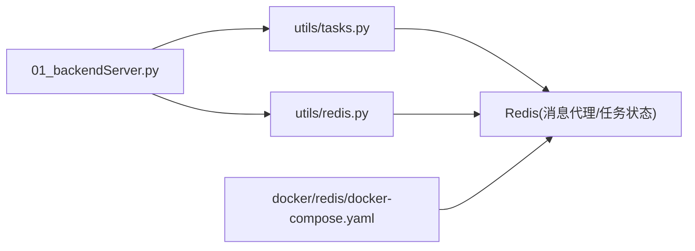

# Redis配置

<cite>
**本文引用的文件**
- [utils/config.py](file://utils/config.py)
- [utils/redis.py](file://utils/redis.py)
- [docker/redis/docker-compose.yaml](file://docker/redis/docker-compose.yaml)
- [01_backendServer.py](file://01_backendServer.py)
- [utils/tasks.py](file://utils/tasks.py)
- [redisTest.py](file://redisTest.py)
</cite>

## 目录
1. [简介](#简介)
2. [项目结构](#项目结构)
3. [核心组件](#核心组件)
4. [架构总览](#架构总览)
5. [详细组件分析](#详细组件分析)
6. [依赖关系分析](#依赖关系分析)
7. [性能与容量规划](#性能与容量规划)
8. [故障排查指南](#故障排查指南)
9. [结论](#结论)
10. [附录：部署与运维清单](#附录部署与运维清单)

## 简介
本文件面向开发者，系统化说明项目中Redis的配置、会话管理、Celery消息代理与任务超时、Docker化部署、高可用与集群方案、连接故障排查与性能监控建议。目标是确保开发者能够正确配置和管理Redis服务，保障多用户多会话的稳定性与可扩展性。

## 项目结构
本项目使用Redis作为会话状态与任务状态的存储后端，并通过Celery将智能体执行任务异步化。关键位置如下：
- 统一配置：集中定义Redis连接参数、会话超时、TTL以及Celery Broker URL等
- Redis会话管理：封装异步Redis客户端，提供会话创建、更新、查询、清理、任务状态绑定等功能
- 后端服务：在应用生命周期中初始化Redis会话管理器，并在API层调用
- Celery任务：通过Redis作为消息代理，实现任务的调度与结果持久化
- Docker Compose：提供一键启动Redis容器，包含数据卷与健康检查

图表来源
- [01_backendServer.py:84-123](file://01_backendServer.py#L84-L123)
- [utils/redis.py:37-49](file://utils/redis.py#L37-L49)
- [utils/tasks.py:43-63](file://utils/tasks.py#L43-L63)
- [docker/redis/docker-compose.yaml:5-28](file://docker/redis/docker-compose.yaml#L5-L28)

章节来源
- [01_backendServer.py:84-123](file://01_backendServer.py#L84-L123)
- [utils/config.py:18-26](file://utils/config.py#L18-L26)
- [utils/redis.py:37-49](file://utils/redis.py#L37-L49)
- [utils/tasks.py:43-63](file://utils/tasks.py#L43-L63)
- [docker/redis/docker-compose.yaml:5-28](file://docker/redis/docker-compose.yaml#L5-L28)

## 核心组件
- 统一配置类：集中管理Redis连接（REDIS_HOST、REDIS_PORT、REDIS_DB）、会话超时（SESSION_TIMEOUT）、TTL、Celery Broker URL（CELERY_BROKER_URL）与任务TTL（TASK_TTL）
- Redis会话管理器：基于异步Redis客户端，提供多用户多会话的CRUD、任务状态绑定、过期清理、统计与删除能力
- Celery集成：以Redis为消息代理，任务序列化采用JSON，时区设置为Asia/Shanghai，启用UTC
- Docker Compose：提供Redis容器化部署，含端口映射、数据卷持久化、健康检查与网络隔离

章节来源
- [utils/config.py:18-26](file://utils/config.py#L18-L26)
- [utils/redis.py:37-49](file://utils/redis.py#L37-L49)
- [utils/tasks.py:43-63](file://utils/tasks.py#L43-L63)
- [docker/redis/docker-compose.yaml:5-28](file://docker/redis/docker-compose.yaml#L5-L28)

## 架构总览
系统通过FastAPI接收请求，利用Redis维护会话与任务状态；同时通过Celery将耗时任务投递到后台Worker执行，任务状态与中间结果也落盘至Redis。Docker Compose负责拉起Redis服务，保证本地或CI环境的一致运行。

图表来源
- [01_backendServer.py:132-173](file://01_backendServer.py#L132-L173)
- [utils/redis.py:65-103](file://utils/redis.py#L65-L103)
- [utils/tasks.py:318-451](file://utils/tasks.py#L318-L451)

## 详细组件分析

### 配置项说明（Redis连接与会话/TTL）
- REDIS_HOST、REDIS_PORT、REDIS_DB：定义Redis服务端地址、端口与数据库编号，用于构建Redis客户端连接
- SESSION_TIMEOUT：默认会话过期时间（秒），用于会话键的过期策略
- TTL：会话数据的TTL，用于覆盖默认会话超时，控制具体会话的生命周期
- CELERY_BROKER_URL：Celery消息代理URL，指向Redis实例，用于任务队列通信
- TASK_TTL：任务状态键的过期时间（秒），避免任务状态长期占用内存

章节来源
- [utils/config.py:18-26](file://utils/config.py#L18-L26)

### Redis会话管理器（数据结构与流程）
- 会话键命名：session:{user_id}:{session_id}:{task_id}，存储会话状态、最近查询、最近响应与更新时间
- 索引集合：
  - user_sessions:{user_id}：记录该用户的session_id:task_id集合
  - task_mapping:{user_id}:{session_id}：记录该会话下的task_id集合
- 任务状态键：task:{task_id}，存储任务ID、状态、结果、错误信息、关联的用户与会话
- 过期策略：会话与映射均设置TTL，支持按会话粒度延长或缩短有效期
- 清理机制：定期扫描并清理无效任务与空集合，防止内存泄漏

图表来源
- [utils/redis.py:65-103](file://utils/redis.py#L65-L103)
- [utils/redis.py:106-144](file://utils/redis.py#L106-L144)
- [utils/redis.py:247-341](file://utils/redis.py#L247-L341)
- [utils/redis.py:369-442](file://utils/redis.py#L369-L442)

章节来源
- [utils/redis.py:37-49](file://utils/redis.py#L37-L49)
- [utils/redis.py:65-103](file://utils/redis.py#L65-L103)
- [utils/redis.py:106-144](file://utils/redis.py#L106-L144)
- [utils/redis.py:247-341](file://utils/redis.py#L247-L341)
- [utils/redis.py:369-442](file://utils/redis.py#L369-L442)

### Celery消息代理与任务超时
- 消息代理：通过CELERY_BROKER_URL指定Redis作为Broker，任务与结果均采用JSON序列化
- 时区与UTC：设置时区为Asia/Shanghai，并启用UTC，便于日志与调度一致性
- 任务TTL：TASK_TTL控制任务状态键的过期时间，避免僵尸任务占用空间
- 任务函数：invoke_agent_task与resume_agent_task分别处理初始执行与恢复执行，内部会更新会话状态与任务状态

图表来源
- [utils/tasks.py:43-63](file://utils/tasks.py#L43-L63)
- [utils/tasks.py:318-451](file://utils/tasks.py#L318-L451)
- [utils/tasks.py:455-559](file://utils/tasks.py#L455-L559)

章节来源
- [utils/tasks.py:43-63](file://utils/tasks.py#L43-L63)
- [utils/tasks.py:318-451](file://utils/tasks.py#L318-L451)
- [utils/tasks.py:455-559](file://utils/tasks.py#L455-L559)

### Docker容器化部署（Redis）
- 镜像与端口：使用官方Redis镜像，暴露6379端口
- 数据持久化：挂载redis-data卷到/data，确保重启后数据不丢失
- 健康检查：通过redis-cli ping进行健康探测，间隔30s，超时10s，重试3次
- 网络：加入app-network，便于与其他服务通信
- 自动重启：restart: unless-stopped，提升可用性

章节来源
- [docker/redis/docker-compose.yaml:5-28](file://docker/redis/docker-compose.yaml#L5-L28)
- [docker/redis/docker-compose.yaml:30-38](file://docker/redis/docker-compose.yaml#L30-L38)

### 高可用与集群方案（建议）
当前仓库未内置Redis集群配置，但可按以下方向扩展：
- 主从复制：至少一主一从，读写分离，提升读吞吐与容灾能力
- Sentinel：在主从基础上增加Sentinel，实现自动故障转移
- Cluster模式：横向扩展分片，适用于大规模会话与任务状态存储
- 网络与安全：限制访问IP白名单，启用TLS加密传输，生产环境建议独立VPC/子网
- 备份与恢复：结合AOF/RDB策略，制定定时快照与增量备份计划

[本节为概念性建议，不直接引用具体代码文件]

## 依赖关系分析
- 后端服务依赖Redis会话管理器进行会话与任务状态管理
- Celery任务依赖Redis作为消息代理与结果存储
- Docker Compose提供Redis运行环境与持久化

图表来源
- [01_backendServer.py:84-123](file://01_backendServer.py#L84-L123)
- [utils/redis.py:37-49](file://utils/redis.py#L37-L49)
- [utils/tasks.py:43-63](file://utils/tasks.py#L43-L63)
- [docker/redis/docker-compose.yaml:5-28](file://docker/redis/docker-compose.yaml#L5-L28)

章节来源
- [01_backendServer.py:84-123](file://01_backendServer.py#L84-L123)
- [utils/redis.py:37-49](file://utils/redis.py#L37-L49)
- [utils/tasks.py:43-63](file://utils/tasks.py#L43-L63)
- [docker/redis/docker-compose.yaml:5-28](file://docker/redis/docker-compose.yaml#L5-L28)

## 性能与容量规划
- 内存管理
  - 合理设置maxmemory与淘汰策略（如allkeys-lru），避免OOM
  - 根据会话规模估算键数量与平均大小，预留冗余内存
- 持久化策略
  - 开启AOF与RDB组合策略，平衡性能与数据安全
  - 调整fsync策略与快照频率，降低IO抖动
- 连接池与并发
  - 应用侧复用Redis连接，避免频繁建立/关闭连接
  - 控制并发任务数，避免对Redis造成突发压力
- 监控指标
  - 关注used_memory、mem_fragmentation_ratio、connected_clients、keyspace_misses、expired_keys、instantaneous_ops_per_sec
  - 结合慢查询日志定位热点键与长耗时命令

[本节为通用指导，不直接引用具体代码文件]

## 故障排查指南
- 连接失败
  - 检查REDIS_HOST、REDIS_PORT、REDIS_DB是否与Docker Compose一致
  - 确认防火墙/安全组放行6379端口
  - 验证容器是否健康（healthcheck通过）
- 会话/任务状态异常
  - 查看清理逻辑是否误删键（cleanup_user_tasks/cleanup_all_tasks）
  - 核对TTL与SESSION_TIMEOUT是否过短导致过早过期
  - 检查任务状态键task:{task_id}是否存在且未过期
- Celery任务问题
  - 确认CELERY_BROKER_URL指向正确的Redis实例
  - 检查Worker进程是否启动并消费队列
  - 查看任务序列化格式与接受内容类型是否匹配
- 日志与调试
  - 应用日志输出到logfile/app.log，可定位初始化、会话创建/更新、任务状态变更
  - 使用redisTest.py进行端到端测试，验证会话创建、查询、清理与删除

章节来源
- [01_backendServer.py:84-123](file://01_backendServer.py#L84-L123)
- [utils/redis.py:247-341](file://utils/redis.py#L247-L341)
- [utils/tasks.py:318-451](file://utils/tasks.py#L318-L451)
- [redisTest.py:462-566](file://redisTest.py#L462-L566)

## 结论
本项目通过统一的配置管理Redis连接与会话/TTL，借助Redis会话管理器实现多用户多会话的状态管理与清理，使用Celery将智能体任务异步化并以Redis作为消息代理与结果存储。Docker Compose简化了本地与CI环境的部署。生产环境中建议引入主从/哨兵/集群、完善安全与监控策略，以确保高可用与可扩展性。

[本节为总结性内容，不直接引用具体代码文件]

## 附录：部署与运维清单
- 启动Redis
  - 使用docker/redis/docker-compose.yaml启动容器，确认端口映射与健康检查通过
- 配置校验
  - 确认utils/config.py中的REDIS_HOST、REDIS_PORT、REDIS_DB与Docker一致
  - 设置合理的SESSION_TIMEOUT与TTL，避免会话过早过期
  - 设置CELERY_BROKER_URL指向Redis实例，确保任务队列正常
- 运行与测试
  - 启动后端服务，观察初始化日志与Redis连接成功
  - 使用redisTest.py进行端到端测试，验证会话创建、查询、清理与删除
- 监控与告警
  - 采集Redis关键指标，设置阈值告警（内存、连接数、命中率、慢查询）
  - 定期巡检过期键与碎片率，必要时调整内存与淘汰策略
- 高可用与扩容
  - 逐步引入主从、哨兵或集群，评估读写分离与分片收益
  - 制定备份与恢复演练计划，确保数据安全

[本节为操作性建议，不直接引用具体代码文件]