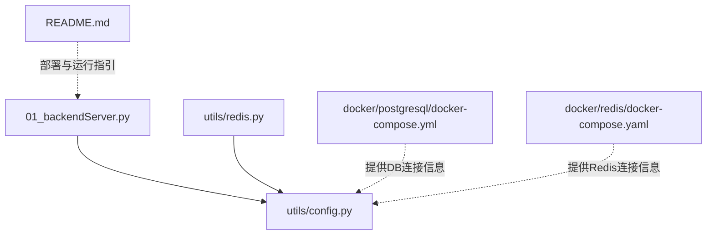
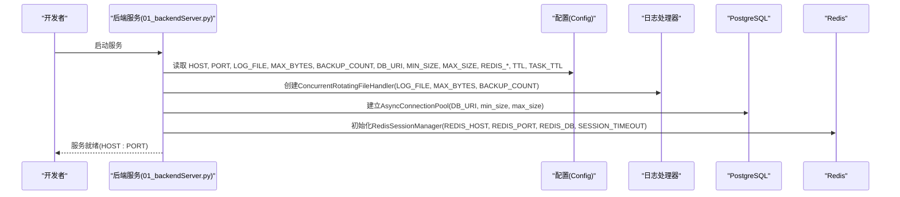
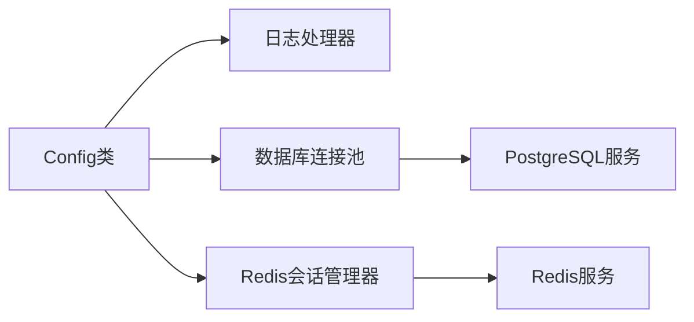

# 应用配置

<cite>
**本文引用的文件**
- [utils/config.py](file://utils/config.py)
- [01_backendServer.py](file://01_backendServer.py)
- [utils/redis.py](file://utils/redis.py)
- [docker/postgresql/docker-compose.yml](file://docker/postgresql/docker-compose.yml)
- [docker/redis/docker-compose.yaml](file://docker/redis/docker-compose.yaml)
- [README.md](file://README.md)
</cite>

## 目录
1. [简介](#简介)
2. [项目结构](#项目结构)
3. [核心组件](#核心组件)
4. [架构总览](#架构总览)
5. [详细组件分析](#详细组件分析)
6. [依赖关系分析](#依赖关系分析)
7. [性能考量](#性能考量)
8. [故障排查指南](#故障排查指南)
9. [结论](#结论)
10. [附录](#附录)

## 简介
本文件面向开发者，系统化说明应用的统一配置管理设计。重点围绕 Config 类中的日志、API服务、数据库、缓存与任务队列等核心参数，解释每个配置项的含义、默认值、取值范围与使用场景；说明环境变量使用方法与最佳实践；给出配置校验与错误处理策略；并对比开发环境与生产环境的差异，帮助开发者正确理解与配置应用基本参数。

## 项目结构
本项目采用集中式配置管理：所有关键运行参数集中在 utils/config.py 的 Config 类中，后端服务通过导入该配置类获取运行时参数，并在启动时初始化日志、数据库连接池、Redis会话管理等资源。前端脚本通过硬编码的后端地址访问 API。

图表来源
- [01_backendServer.py:14-33](file://01_backendServer.py#L14-L33)
- [utils/config.py:4-33](file://utils/config.py#L4-L33)
- [utils/redis.py:19-25](file://utils/redis.py#L19-L25)
- [docker/postgresql/docker-compose.yml:7-13](file://docker/postgresql/docker-compose.yml#L7-L13)
- [docker/redis/docker-compose.yaml:11-13](file://docker/redis/docker-compose.yaml#L11-L13)

章节来源
- [utils/config.py:4-33](file://utils/config.py#L4-L33)
- [01_backendServer.py:14-33](file://01_backendServer.py#L14-L33)
- [utils/redis.py:19-25](file://utils/redis.py#L19-L25)

## 核心组件
Config 类是统一的配置中心，涵盖以下类别：
- 日志配置：LOG_FILE、MAX_BYTES、BACKUP_COUNT
- API服务配置：HOST、PORT
- PostgreSQL配置：DB_URI、MIN_SIZE、MAX_SIZE
- Redis配置：REDIS_HOST、REDIS_PORT、REDIS_DB、SESSION_TIMEOUT、TTL
- Celery配置：CELERY_BROKER_URL、TASK_TTL
- LLM类型：LLM_TYPE

这些配置在应用启动时被读取并使用，贯穿日志轮转、数据库连接池、Redis会话管理与异步任务队列。

章节来源
- [utils/config.py:4-33](file://utils/config.py#L4-L33)
- [01_backendServer.py:21-33](file://01_backendServer.py#L21-L33)
- [utils/redis.py:19-25](file://utils/redis.py#L19-L25)

## 架构总览
下图展示了配置在系统中的作用位置与数据流：后端服务启动时读取配置，初始化日志处理器、数据库连接池、Redis会话管理器；前端通过HTTP调用后端API。

图表来源
- [01_backendServer.py:21-33](file://01_backendServer.py#L21-L33)
- [01_backendServer.py:84-123](file://01_backendServer.py#L84-L123)
- [utils/config.py:4-33](file://utils/config.py#L4-L33)
- [utils/redis.py:19-25](file://utils/redis.py#L19-L25)

## 详细组件分析

### 日志配置（LOG_FILE、MAX_BYTES、BACKUP_COUNT）
- LOG_FILE
  - 含义：日志文件路径，用于持久化存储应用日志
  - 默认值：logfile/app.log
  - 取值范围：任意可写路径；建议位于项目根目录下 logfile 子目录
  - 使用场景：后端与工具模块统一输出结构化日志，便于问题定位
  - 注意事项：模块加载时会确保目录存在；若路径不可写将导致异常
- MAX_BYTES
  - 含义：单个日志文件的最大字节数，达到后触发轮转
  - 默认值：5*1024*1024（5MB）
  - 取值范围：正整数；过大影响磁盘占用，过小导致频繁轮转
  - 使用场景：控制单文件体积，配合备份数量实现滚动日志
- BACKUP_COUNT
  - 含义：保留的历史日志文件数量
  - 默认值：3
  - 取值范围：非负整数；0表示不保留历史文件
  - 使用场景：平衡磁盘空间与回溯能力

章节来源
- [utils/config.py:6-11](file://utils/config.py#L6-L11)
- [01_backendServer.py:21-33](file://01_backendServer.py#L21-L33)
- [utils/redis.py:19-25](file://utils/redis.py#L19-L25)

### API服务配置（HOST、PORT）
- HOST
  - 含义：服务监听地址
  - 默认值：0.0.0.0（绑定所有网络接口）
  - 取值范围：IPv4/IPv6地址或域名；生产环境建议使用具体IP或内网地址
  - 使用场景：控制对外暴露的网络接口
- PORT
  - 含义：服务监听端口
  - 默认值：8001
  - 取值范围：1-65535；需避免与其他服务冲突
  - 使用场景：前后端通信入口

章节来源
- [utils/config.py:31-33](file://utils/config.py#L31-L33)
- [01_backendServer.py:418-423](file://01_backendServer.py#L418-L423)

### PostgreSQL配置（DB_URI、MIN_SIZE、MAX_SIZE）
- DB_URI
  - 含义：PostgreSQL连接字符串
  - 默认值：从环境变量 DB_URI 读取，否则使用内置默认值
  - 取值范围：标准PostgreSQL URI格式；包含主机、端口、数据库名、用户、密码、SSL模式等
  - 使用场景：构建异步连接池，支撑短期记忆与状态持久化
  - 环境变量：DB_URI（推荐在生产环境设置）
- MIN_SIZE / MAX_SIZE
  - 含义：连接池最小/最大连接数
  - 默认值：5 / 10
  - 取值范围：正整数；根据并发与数据库负载调整
  - 使用场景：控制数据库连接资源上限与复用效率

章节来源
- [utils/config.py:13-16](file://utils/config.py#L13-L16)
- [01_backendServer.py:94-102](file://01_backendServer.py#L94-L102)
- [docker/postgresql/docker-compose.yml:7-13](file://docker/postgresql/docker-compose.yml#L7-L13)

### Redis配置（REDIS_HOST、REDIS_PORT、REDIS_DB、SESSION_TIMEOUT、TTL）
- REDIS_HOST / REDIS_PORT / REDIS_DB
  - 含义：Redis服务器地址、端口、库索引
  - 默认值：localhost / 6379 / 0
  - 取值范围：有效主机名或IP；端口为1-65535；库索引为0-15（取决于服务端配置）
  - 使用场景：会话状态、任务映射、过期清理
- SESSION_TIMEOUT
  - 含义：会话默认过期时间（秒）
  - 默认值：300
  - 取值范围：正整数；根据业务交互时长调整
- TTL
  - 含义：会话键的过期时间（秒），可在更新时覆盖
  - 默认值：3600
  - 取值范围：正整数；用于控制会话存活周期

章节来源
- [utils/config.py:18-23](file://utils/config.py#L18-L23)
- [utils/redis.py:40-49](file://utils/redis.py#L40-L49)
- [docker/redis/docker-compose.yaml:11-13](file://docker/redis/docker-compose.yaml#L11-L13)

### Celery配置（CELERY_BROKER_URL、TASK_TTL）
- CELERY_BROKER_URL
  - 含义：Celery消息代理URL，当前基于Redis
  - 默认值：redis://localhost:6379/0
  - 取值范围：支持Redis URL格式；生产环境建议使用独立实例或VPC内网地址
- TASK_TTL
  - 含义：任务状态键的过期时间（秒）
  - 默认值：3600
  - 取值范围：正整数；根据任务执行时长与清理策略调整

章节来源
- [utils/config.py:25-26](file://utils/config.py#L25-L26)
- [utils/redis.py:405-415](file://utils/redis.py#L405-L415)

### LLM类型（LLM_TYPE）
- 含义：选择大模型提供方或本地方案
- 默认值：qwen
- 取值范围：openai / qwen / oneapi / ollama（依据代码注释）
- 使用场景：决定后续模型调用路由与适配层

章节来源
- [utils/config.py:28-29](file://utils/config.py#L28-L29)

## 依赖关系分析
- 后端服务依赖配置类以初始化日志、数据库连接池、Redis会话管理
- Redis会话管理器依赖配置类提供的连接参数与会话超时
- Docker Compose 提供PostgreSQL与Redis的运行环境，其端口与凭据应与配置一致

图表来源
- [01_backendServer.py:21-33](file://01_backendServer.py#L21-L33)
- [01_backendServer.py:94-102](file://01_backendServer.py#L94-L102)
- [utils/redis.py:40-49](file://utils/redis.py#L40-L49)
- [docker/postgresql/docker-compose.yml:7-13](file://docker/postgresql/docker-compose.yml#L7-L13)
- [docker/redis/docker-compose.yaml:11-13](file://docker/redis/docker-compose.yaml#L11-L13)

章节来源
- [01_backendServer.py:21-33](file://01_backendServer.py#L21-L33)
- [utils/redis.py:40-49](file://utils/redis.py#L40-L49)

## 性能考量
- 日志轮转
  - MAX_BYTES 与 BACKUP_COUNT 共同影响磁盘I/O与空间占用；高吞吐场景可适当增大单文件大小以减少轮转频率
- 数据库连接池
  - MIN_SIZE/MAX_SIZE 应根据并发请求量与数据库承载能力调优；过高会导致连接竞争与内存压力
- Redis会话与任务TTL
  - 合理设置 SESSION_TIMEOUT/TASK_TTL 可减少无效数据累积；过短可能导致会话丢失，过长则增加内存压力
- 网络与端口
  - HOST/PORT 应结合部署网络拓扑；生产环境建议限制到内网或反向代理之后

[本节为通用指导，无需特定文件引用]

## 故障排查指南
- 日志无法写入
  - 检查 LOG_FILE 路径是否存在且可写；模块会在加载时尝试创建目录
  - 参考：日志处理器初始化处
- 数据库连接失败
  - 检查 DB_URI 是否正确，尤其是主机、端口、用户名、密码、数据库名与SSL模式
  - 确认PostgreSQL服务已启动且端口可达
  - 参考：连接池初始化处
- Redis连接失败
  - 检查 REDIS_HOST/REDIS_PORT/REDIS_DB 是否与Docker Compose暴露一致
  - 确认Redis服务健康检查通过
  - 参考：Redis会话管理器初始化处
- 端口冲突
  - 修改 HOST/PORT 避免与本机其他服务冲突
  - 参考：服务启动处

章节来源
- [01_backendServer.py:21-33](file://01_backendServer.py#L21-L33)
- [01_backendServer.py:94-102](file://01_backendServer.py#L94-L102)
- [utils/redis.py:40-49](file://utils/redis.py#L40-L49)
- [docker/postgresql/docker-compose.yml:7-13](file://docker/postgresql/docker-compose.yml#L7-L13)
- [docker/redis/docker-compose.yaml:11-13](file://docker/redis/docker-compose.yaml#L11-L13)

## 结论
通过统一的 Config 类集中管理应用参数，实现了日志、API服务、数据库、缓存与任务队列的可配置化与可维护性。结合环境变量与Docker Compose，可以灵活切换开发与生产环境。建议在部署前完成配置校验与环境变量注入，确保服务稳定运行。

[本节为总结性内容，无需特定文件引用]

## 附录

### 配置项清单与说明
- 日志
  - LOG_FILE：日志文件路径；默认 logfile/app.log
  - MAX_BYTES：单文件最大大小；默认 5MB
  - BACKUP_COUNT：保留历史文件数；默认 3
- API服务
  - HOST：监听地址；默认 0.0.0.0
  - PORT：监听端口；默认 8001
- PostgreSQL
  - DB_URI：连接串；默认来自环境变量 DB_URI，否则内置默认值
  - MIN_SIZE：连接池最小连接数；默认 5
  - MAX_SIZE：连接池最大连接数；默认 10
- Redis
  - REDIS_HOST：默认 localhost
  - REDIS_PORT：默认 6379
  - REDIS_DB：默认 0
  - SESSION_TIMEOUT：会话默认过期时间（秒）；默认 300
  - TTL：会话键过期时间（秒）；默认 3600
- Celery
  - CELERY_BROKER_URL：消息代理URL；默认 redis://localhost:6379/0
  - TASK_TTL：任务状态过期时间（秒）；默认 3600
- LLM
  - LLM_TYPE：模型提供方；默认 qwen

章节来源
- [utils/config.py:4-33](file://utils/config.py#L4-L33)

### 环境变量使用与最佳实践
- 使用方式
  - DB_URI：通过 os.getenv("DB_URI", default) 读取；未设置时使用内置默认值
  - 其他参数目前为常量，可通过修改 Config 类或在启动前注入环境变量扩展
- 最佳实践
  - 生产环境务必通过环境变量注入敏感信息（如数据库凭据）
  - 不同环境使用不同的 .env 或容器编排注入，避免硬编码
  - 对关键参数进行启动前校验（如端口可用、路径可写、连接可达）

章节来源
- [utils/config.py:14](file://utils/config.py#L14)
- [README.md:112-118](file://README.md#L112-L118)

### 配置验证机制与错误处理策略
- 现有机制
  - 日志目录自动创建；若不可写将抛出异常
  - 数据库连接池在应用生命周期中显式打开；失败时记录错误并抛出运行时异常
  - Redis会话管理器在初始化时建立连接；连接失败将中断服务启动
- 建议增强
  - 在应用启动阶段增加配置校验函数，检查必填项、取值范围与连通性
  - 对异常进行统一捕获与降级提示，便于运维快速定位

章节来源
- [utils/config.py:7-11](file://utils/config.py#L7-L11)
- [01_backendServer.py:84-123](file://01_backendServer.py#L84-L123)
- [utils/redis.py:40-49](file://utils/redis.py#L40-L49)

### 开发环境与生产环境差异
- 开发环境
  - 使用本地或Docker Compose启动PostgreSQL与Redis
  - 端口与凭据与 docker-compose 配置一致
  - 日志级别较低，便于调试
- 生产环境
  - 使用环境变量注入 DB_URI 等敏感配置
  - 调整连接池大小、日志轮转策略与会话TTL以适应高并发
  - 限制 HOST 为内网地址或通过反向代理暴露

章节来源
- [docker/postgresql/docker-compose.yml:7-13](file://docker/postgresql/docker-compose.yml#L7-L13)
- [docker/redis/docker-compose.yaml:11-13](file://docker/redis/docker-compose.yaml#L11-L13)
- [utils/config.py:14](file://utils/config.py#L14)
- [README.md:112-118](file://README.md#L112-L118)