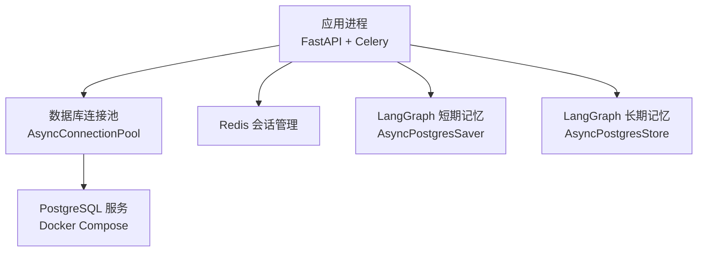
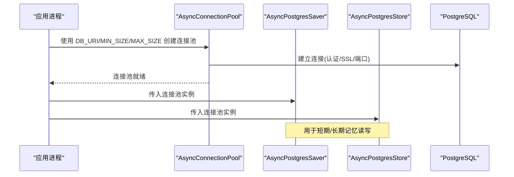
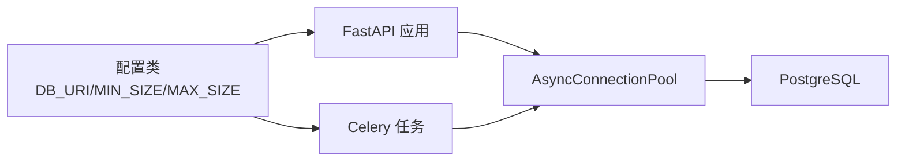

# 数据库配置

<cite>
**本文引用的文件**
- [utils/config.py](file://utils/config.py)
- [01_backendServer.py](file://01_backendServer.py)
- [utils/tasks.py](file://utils/tasks.py)
- [docker/postgresql/docker-compose.yml](file://docker/postgresql/docker-compose.yml)
- [README.md](file://README.md)
</cite>

## 目录
1. [简介](#简介)
2. [项目结构](#项目结构)
3. [核心组件](#核心组件)
4. [架构总览](#架构总览)
5. [详细组件分析](#详细组件分析)
6. [依赖关系分析](#依赖关系分析)
7. [性能考虑](#性能考虑)
8. [故障排查指南](#故障排查指南)
9. [结论](#结论)
10. [附录](#附录)

## 简介
本文件面向开发者，提供本项目中 PostgreSQL 数据库配置的完整说明与最佳实践。内容涵盖：
- 连接字符串 DB_URI 的格式、认证参数、SSL 模式等
- 连接池 MIN_SIZE、MAX_SIZE 的作用与调优方法
- Docker 容器化部署 PostgreSQL 的数据持久化、网络、环境变量与健康检查
- 不同环境的配置示例与注意事项
- 常见连接问题排查与性能优化建议

## 项目结构
本项目将数据库相关配置集中在统一配置类中，并在服务启动时创建异步连接池，供短期记忆（Checkpointer）与长期记忆（Store）使用；同时通过 Docker Compose 提供本地开发/测试所需的 PostgreSQL 服务。

图表来源
- [01_backendServer.py:94-110](file://01_backendServer.py#L94-L110)
- [utils/tasks.py:350-362](file://utils/tasks.py#L350-L362)
- [docker/postgresql/docker-compose.yml:4-22](file://docker/postgresql/docker-compose.yml#L4-L22)

章节来源
- [utils/config.py:13-16](file://utils/config.py#L13-L16)
- [01_backendServer.py:94-110](file://01_backendServer.py#L94-L110)
- [docker/postgresql/docker-compose.yml:4-22](file://docker/postgresql/docker-compose.yml#L4-L22)

## 核心组件
- 配置集中管理：DB_URI、MIN_SIZE、MAX_SIZE 等数据库相关参数在统一配置类中定义，便于环境切换与管理。
- 连接池初始化：服务启动时基于配置创建并打开异步连接池，随后注入到 LangGraph 的 Checkpointer 与 Store。
- 任务执行复用：Celery Worker 在执行任务时也会按需创建连接池并使用相同配置。

章节来源
- [utils/config.py:13-16](file://utils/config.py#L13-L16)
- [01_backendServer.py:94-110](file://01_backendServer.py#L94-L110)
- [utils/tasks.py:350-362](file://utils/tasks.py#L350-L362)

## 架构总览
下图展示了从应用启动到数据库连接池建立，再到 LangGraph 存储组件初始化的整体流程。

图表来源
- [01_backendServer.py:94-110](file://01_backendServer.py#L94-L110)
- [utils/tasks.py:350-362](file://utils/tasks.py#L350-L362)

## 详细组件分析

### 数据库连接配置（DB_URI）
- 位置与默认值：DB_URI 在配置类中定义，支持通过环境变量覆盖；若未设置则使用内置默认值。
- 连接字符串组成：包含协议、用户名、密码、主机、端口、数据库名以及查询参数（如 SSL 模式）。
- 认证参数：用户名与密码来自连接字符串；与 Docker 中的 POSTGRES_USER/POSTGRES_PASSWORD 保持一致。
- SSL 模式：默认使用禁用 SSL 的模式以适配本地开发；生产环境应启用并配置证书。
- 环境变量优先：推荐在生产环境中通过环境变量注入 DB_URI，避免硬编码敏感信息。

章节来源
- [utils/config.py:13-16](file://utils/config.py#L13-L16)
- [docker/postgresql/docker-compose.yml:7-11](file://docker/postgresql/docker-compose.yml#L7-L11)

### 连接池配置（MIN_SIZE、MAX_SIZE）
- 作用：
  - MIN_SIZE：连接池最小空闲连接数，减少冷启动时的连接建立开销。
  - MAX_SIZE：连接池最大并发连接数，限制对数据库的最大并发访问，防止资源耗尽。
- 使用位置：
  - 服务启动时创建全局连接池并显式打开。
  - Celery Worker 在执行任务时也会创建连接池（或使用上下文管理器），确保任务隔离与资源释放。
- 调优建议：
  - 根据并发请求量与数据库服务器资源设定 MAX_SIZE，避免超过数据库 max_connections。
  - 将 MIN_SIZE 设置为一个较小的常驻连接数，提升高并发下的首条请求响应时间。
  - 结合 autocommit 与 prepare_threshold 等参数优化事务与预编译行为。

章节来源
- [utils/config.py:13-16](file://utils/config.py#L13-L16)
- [01_backendServer.py:94-110](file://01_backendServer.py#L94-L110)
- [utils/tasks.py:350-362](file://utils/tasks.py#L350-L362)

### Docker 容器化 PostgreSQL 部署
- 镜像与版本：使用指定版本的 PostgreSQL 镜像，保证可重复性。
- 环境变量：
  - POSTGRES_USER、POSTGRES_PASSWORD、POSTGRES_DB：用于初始化数据库账户与库名。
  - TZ：设置容器时区，便于日志与时间一致性。
- 数据持久化：通过命名卷挂载到 /var/lib/postgresql/data，确保容器重启后数据不丢失。
- 网络暴露：将容器 5432 端口映射到宿主机，便于本地客户端连接。
- 健康检查：使用 pg_isready 进行健康探测，配合重试策略保障服务可用性。
- 自定义参数：通过 command 传递 postgres 启动参数，例如调整 max_connections。

章节来源
- [docker/postgresql/docker-compose.yml:4-22](file://docker/postgresql/docker-compose.yml#L4-L22)

### 运行时集成（服务与任务）
- 服务启动：
  - 创建 AsyncConnectionPool，传入 DB_URI、MIN_SIZE、MAX_SIZE 及额外参数。
  - 显式打开连接池，随后初始化 LangGraph 的 AsyncPostgresSaver 与 AsyncPostgresStore。
- 任务执行：
  - Celery Worker 在执行 invoke/resume 任务时，同样基于配置创建连接池，完成短期/长期记忆的读写。
  - 任务结束后关闭 Redis 会话管理器，确保资源释放。

章节来源
- [01_backendServer.py:94-110](file://01_backendServer.py#L94-L110)
- [utils/tasks.py:350-362](file://utils/tasks.py#L350-L362)
- [utils/tasks.py:476-482](file://utils/tasks.py#L476-L482)

## 依赖关系分析
- 配置依赖：DB_URI、MIN_SIZE、MAX_SIZE 由配置类集中管理，被服务与任务模块共同引用。
- 运行时依赖：
  - FastAPI 应用生命周期中创建并维护连接池。
  - LangGraph 的 Checkpointer/Store 依赖连接池进行状态与数据的持久化。
  - Celery Worker 在任务执行期间按需创建连接池，避免长驻连接泄漏。
- 外部依赖：PostgreSQL 通过 Docker Compose 提供，Redis 用于会话管理（不在本文重点）。

图表来源
- [utils/config.py:13-16](file://utils/config.py#L13-L16)
- [01_backendServer.py:94-110](file://01_backendServer.py#L94-L110)
- [utils/tasks.py:350-362](file://utils/tasks.py#L350-L362)

章节来源
- [utils/config.py:13-16](file://utils/config.py#L13-L16)
- [01_backendServer.py:94-110](file://01_backendServer.py#L94-L110)
- [utils/tasks.py:350-362](file://utils/tasks.py#L350-L362)

## 性能考虑
- 连接池大小：
  - MAX_SIZE 不应超过数据库 max_connections，避免连接拒绝。
  - MIN_SIZE 可根据平均并发与首包延迟目标设置，减少连接建立开销。
- 事务与预编译：
  - autocommit=True 可减少事务管理开销，适合短事务场景。
  - prepare_threshold=0 控制预编译语句阈值，影响 SQL 执行计划缓存。
- 数据库侧参数：
  - 通过命令参数调整 max_connections，匹配应用并发需求。
  - 合理设置共享内存、工作内存等参数以提升吞吐。
- 监控与容量规划：
  - 观察连接池使用率、等待队列与数据库负载，动态调整 MIN_SIZE/MAX_SIZE。
  - 定期评估数据库资源瓶颈，必要时扩容或分库分表。

[本节为通用性能指导，无需特定文件来源]

## 故障排查指南
- 无法连接数据库：
  - 检查 DB_URI 是否与 Docker 环境变量一致（用户名、密码、数据库名、主机、端口）。
  - 确认 PostgreSQL 容器已启动且端口映射正确。
  - 验证防火墙/安全组是否放行 5432 端口。
- 连接池相关问题：
  - 连接数不足：提高 MAX_SIZE 或数据库 max_connections。
  - 连接泄漏：确保应用退出时关闭连接池；任务中使用上下文管理器自动释放。
- SSL 模式错误：
  - 本地开发可使用禁用 SSL 的模式；生产环境需启用并配置证书。
- 健康检查失败：
  - 检查 healthcheck 的用户名与命令是否正确；必要时调整为实际使用的用户。
- 参考步骤：
  - 使用 README 中的方式启动 PostgreSQL 与 Redis，确保基础环境可用。

章节来源
- [docker/postgresql/docker-compose.yml:7-22](file://docker/postgresql/docker-compose.yml#L7-L22)
- [README.md:111-118](file://README.md#L111-L118)

## 结论
通过将 DB_URI 与连接池参数集中管理，并在服务与任务中统一使用，本项目实现了稳定可靠的 PostgreSQL 集成。借助 Docker Compose 提供的容器化部署方案，开发与测试环境得以快速搭建。建议在生产环境中严格管理环境变量、启用 SSL、合理调优连接池与数据库参数，并持续监控连接与性能指标，以确保系统在高并发场景下的稳定性与可扩展性。

[本节为总结性内容，无需特定文件来源]

## 附录

### 连接字符串与参数说明
- 基本格式：协议://用户名:密码@主机:端口/数据库?参数
- 常用参数：
  - sslmode：控制 SSL 连接模式（本地开发常设为 disable，生产建议启用并配置证书）
  - connect_timeout、statement_timeout 等：控制连接与语句超时
- 环境变量覆盖：推荐通过环境变量注入 DB_URI，避免硬编码敏感信息

章节来源
- [utils/config.py:13-16](file://utils/config.py#L13-L16)

### 连接池调优要点
- MIN_SIZE：保持少量常驻连接，降低冷启动延迟
- MAX_SIZE：根据并发与数据库承载能力设置，避免超过 max_connections
- autocommit：短事务场景可开启以减少事务开销
- prepare_threshold：根据 SQL 复杂度与执行频率调整

章节来源
- [01_backendServer.py:94-110](file://01_backendServer.py#L94-L110)
- [utils/tasks.py:350-362](file://utils/tasks.py#L350-L362)

### Docker 部署清单
- 镜像版本固定：使用具体版本号以保证一致性
- 环境变量：POSTGRES_USER、POSTGRES_PASSWORD、POSTGRES_DB、TZ
- 数据卷：pgdata 持久化至 /var/lib/postgresql/data
- 端口映射：5432:5432
- 健康检查：pg_isready 检测数据库就绪
- 自定义参数：max_connections 等

章节来源
- [docker/postgresql/docker-compose.yml:4-22](file://docker/postgresql/docker-compose.yml#L4-L22)

### 不同环境配置示例（思路）
- 开发环境：
  - DB_URI：指向本地 Docker 容器，sslmode=disable
  - MIN_SIZE/MAX_SIZE：较小值即可满足本地调试
- 测试环境：
  - DB_URI：指向测试数据库，启用 SSL
  - MIN_SIZE/MAX_SIZE：略高于开发环境，模拟一定并发
- 生产环境：
  - DB_URI：通过环境变量注入，启用强加密与证书校验
  - MIN_SIZE/MAX_SIZE：依据压测结果与数据库容量设定
  - 数据库侧：调整 max_connections、内存与 I/O 参数

[本节为概念性示例，无需特定文件来源]