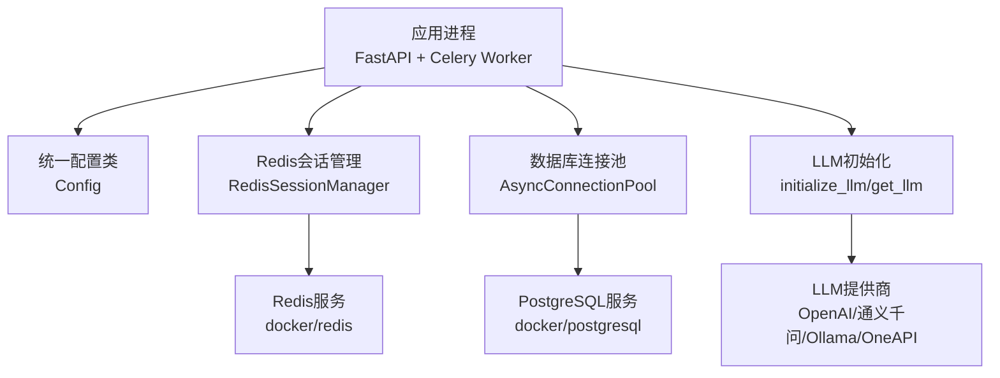
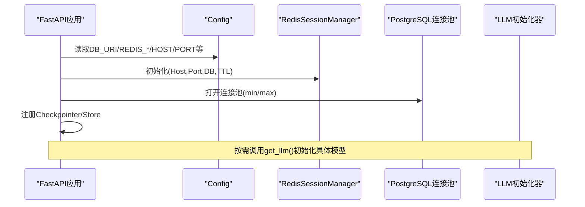
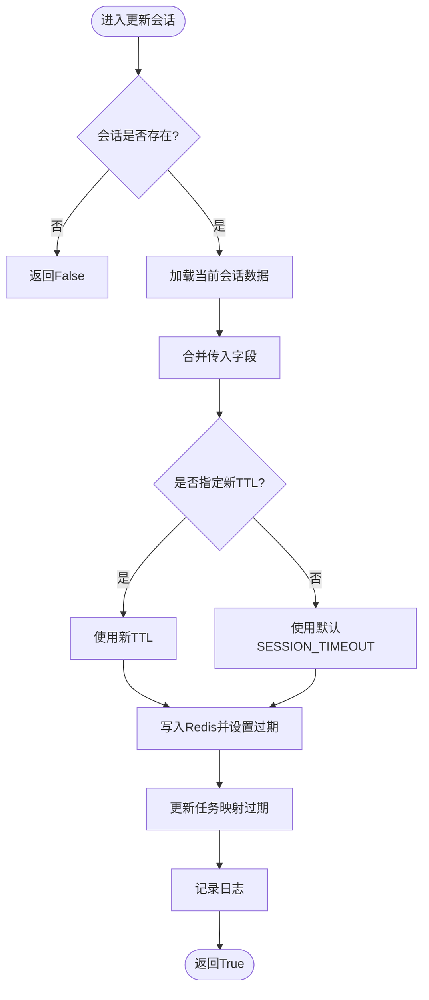
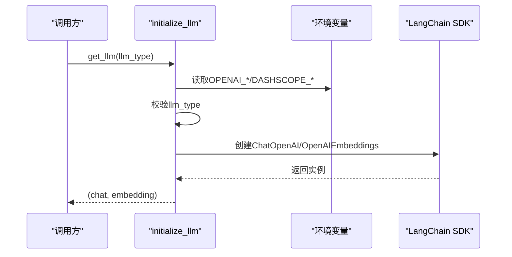
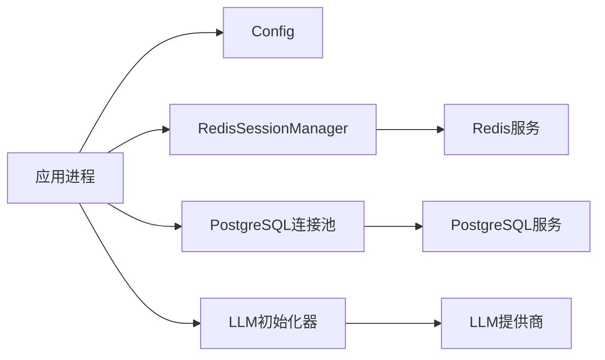

# 配置管理

<cite>
**本文引用的文件列表**
- [utils/config.py](file://utils/config.py)
- [utils/redis.py](file://utils/redis.py)
- [utils/llms.py](file://utils/llms.py)
- [docker/postgresql/docker-compose.yml](file://docker/postgresql/docker-compose.yml)
- [docker/redis/docker-compose.yaml](file://docker/redis/docker-compose.yaml)
- [01_backendServer.py](file://01_backendServer.py)
- [README.md](file://README.md)
</cite>

## 目录
1. [简介](#简介)
2. [项目结构](#项目结构)
3. [核心组件](#核心组件)
4. [架构总览](#架构总览)
5. [详细组件分析](#详细组件分析)
6. [依赖关系分析](#依赖关系分析)
7. [性能与容量规划](#性能与容量规划)
8. [故障排查指南](#故障排查指南)
9. [结论](#结论)
10. [附录：配置模板与环境差异](#附录：配置模板与环境差异)

## 简介
本文件面向开发者，系统化说明本项目的“统一配置类”设计与使用方式，覆盖环境变量、数据库连接、Redis、LLM服务、Docker容器化等关键配置点。文档同时给出不同环境（开发、测试、生产）的配置策略建议，并提供参数含义、默认值、取值范围说明，以及配置文件模板与示例，帮助正确配置与管理系统参数。

## 项目结构
本项目采用集中式配置类统一管理常量与外部依赖的连接信息，并通过环境变量注入敏感或环境相关参数；Redis用于会话状态与任务队列，PostgreSQL用于短期记忆与长期记忆的持久化；LLM通过统一入口按类型初始化不同厂商模型；Docker Compose提供本地一键启动数据库与缓存服务。

图表来源
- [utils/config.py:4-33](file://utils/config.py#L4-L33)
- [utils/redis.py:37-49](file://utils/redis.py#L37-L49)
- [01_backendServer.py:84-123](file://01_backendServer.py#L84-L123)
- [utils/llms.py:70-112](file://utils/llms.py#L70-L112)
- [docker/postgresql/docker-compose.yml:4-22](file://docker/postgresql/docker-compose.yml#L4-L22)
- [docker/redis/docker-compose.yaml:5-28](file://docker/redis/docker-compose.yaml#L5-L28)

章节来源
- [utils/config.py:4-33](file://utils/config.py#L4-L33)
- [01_backendServer.py:84-123](file://01_backendServer.py#L84-L123)
- [README.md:112-118](file://README.md#L112-L118)

## 核心组件
- 统一配置类 Config：集中定义日志、数据库、Redis、Celery、LLM类型、服务监听地址与端口等。支持从环境变量读取敏感信息并设置合理默认值。
- Redis会话管理器：基于异步Redis客户端实现多用户多会话的状态管理、任务状态跟踪、过期清理等。
- LLM初始化器：根据配置的类型选择不同厂商的模型，封装Chat与Embedding实例创建，具备错误处理与回退机制。
- Docker Compose：提供PostgreSQL与Redis服务的容器化部署，包含健康检查、卷持久化、网络等。

章节来源
- [utils/config.py:4-33](file://utils/config.py#L4-L33)
- [utils/redis.py:37-49](file://utils/redis.py#L37-L49)
- [utils/llms.py:70-112](file://utils/llms.py#L70-L112)
- [docker/postgresql/docker-compose.yml:4-22](file://docker/postgresql/docker-compose.yml#L4-L22)
- [docker/redis/docker-compose.yaml:5-28](file://docker/redis/docker-compose.yaml#L5-L28)

## 架构总览
应用启动时通过生命周期函数初始化Redis会话管理器、数据库连接池、短期记忆Checkpointer与长期记忆Store；各模块通过统一配置类获取连接参数；LLM在需要时按类型初始化。

图表来源
- [01_backendServer.py:84-123](file://01_backendServer.py#L84-L123)
- [utils/config.py:13-33](file://utils/config.py#L13-L33)
- [utils/redis.py:37-49](file://utils/redis.py#L37-L49)
- [utils/llms.py:70-112](file://utils/llms.py#L70-L112)

## 详细组件分析

### 统一配置类 Config
- 职责：集中管理所有可配置项，提供默认值与环境变量覆盖能力。
- 关键参数
  - 日志：LOG_FILE、MAX_BYTES、BACKUP_COUNT
  - 数据库：DB_URI、MIN_SIZE、MAX_SIZE
  - Redis：REDIS_HOST、REDIS_PORT、REDIS_DB、SESSION_TIMEOUT、TTL
  - 任务队列：CELERY_BROKER_URL、TASK_TTL
  - LLM：LLM_TYPE（openai/qwen/oneapi/ollama）
  - 服务：HOST、PORT
- 行为要点
  - 自动创建日志目录
  - DB_URI优先读取环境变量，否则使用内置默认值
  - 其他参数提供合理的默认值，便于本地快速运行

章节来源
- [utils/config.py:4-33](file://utils/config.py#L4-L33)

### Redis会话管理
- 职责：维护用户会话、任务状态、过期清理、统计查询等。
- 关键方法
  - create_session/update_session/delete_session
  - get_session_by_task/get_all_users_session_ids/get_session_count
  - set_task_status/get_task_status/get_single_task_status
  - cleanup_user_tasks/cleanup_all_tasks
- 数据键约定
  - session:{user_id}:{session_id}:{task_id}
  - user_sessions:{user_id}
  - task_mapping:{user_id}:{session_id}
  - task:{task_id}
- 超时与TTL
  - 会话级TTL由SESSION_TIMEOUT控制
  - 任务级TTL由TASK_TTL控制

图表来源
- [utils/redis.py:105-144](file://utils/redis.py#L105-L144)

章节来源
- [utils/redis.py:37-493](file://utils/redis.py#L37-L493)

### LLM服务配置与初始化
- 支持类型：openai、qwen、oneapi、ollama
- 环境变量
  - OPENAI_BASE_URL、OPENAI_API_KEY（用于openai）
  - DASHSCOPE_API_KEY（用于qwen）
- 默认行为
  - 未设置时部分字段使用硬编码默认值（如base_url、模型名）
  - ollama类型会设置特殊环境变量以兼容SDK
- 错误处理
  - 校验类型合法性
  - 捕获异常并抛出自定义异常
  - 提供回退到默认类型的重试逻辑

图表来源
- [utils/llms.py:31-57](file://utils/llms.py#L31-L57)
- [utils/llms.py:70-112](file://utils/llms.py#L70-L112)
- [utils/llms.py:122-138](file://utils/llms.py#L122-L138)

章节来源
- [utils/llms.py:31-57](file://utils/llms.py#L31-L57)
- [utils/llms.py:70-112](file://utils/llms.py#L70-L112)
- [utils/llms.py:122-138](file://utils/llms.py#L122-L138)

### Docker容器化配置
- PostgreSQL
  - 镜像版本固定为15
  - 环境变量：POSTGRES_USER、POSTGRES_PASSWORD、POSTGRES_DB、TZ
  - 端口映射：5432
  - 数据卷：pgdata
  - 健康检查：pg_isready
  - 最大连接数：max_connections=200
- Redis
  - 镜像：latest
  - 端口映射：6379
  - 数据卷：redis-data
  - 健康检查：redis-cli ping
  - 网络：app-network

章节来源
- [docker/postgresql/docker-compose.yml:4-22](file://docker/postgresql/docker-compose.yml#L4-L22)
- [docker/redis/docker-compose.yaml:5-28](file://docker/redis/docker-compose.yaml#L5-L28)

## 依赖关系分析
- 应用层依赖
  - FastAPI/Celery：后端服务与异步任务
  - psycopg_pool：异步PostgreSQL连接池
  - redis.asyncio：异步Redis客户端
  - langchain-openai：LLM抽象与适配
- 配置依赖
  - 所有模块通过统一配置类获取连接参数，降低耦合度
  - 敏感信息通过环境变量注入，避免硬编码

图表来源
- [01_backendServer.py:84-123](file://01_backendServer.py#L84-L123)
- [utils/config.py:13-33](file://utils/config.py#L13-L33)
- [utils/redis.py:37-49](file://utils/redis.py#L37-L49)
- [utils/llms.py:70-112](file://utils/llms.py#L70-L112)

章节来源
- [01_backendServer.py:84-123](file://01_backendServer.py#L84-L123)
- [utils/config.py:13-33](file://utils/config.py#L13-L33)

## 性能与容量规划
- 数据库连接池
  - MIN_SIZE/MAX_SIZE：建议根据并发请求量与数据库资源调整，避免过大导致连接耗尽
- Redis会话与任务
  - SESSION_TIMEOUT/TASK_TTL：根据业务交互时长与任务耗时调整，防止内存占用过高
- 日志轮转
  - MAX_BYTES/BACKUP_COUNT：控制日志文件大小与保留数量，平衡磁盘占用与可追溯性
- LLM超时与重试
  - 初始化时设置timeout与max_retries，提升稳定性

[本节为通用指导，不直接分析具体文件]

## 故障排查指南
- 无法连接数据库
  - 检查DB_URI是否正确，PostgreSQL容器是否启动成功
  - 确认端口映射与健康检查通过
- Redis不可用
  - 检查REDIS_HOST/PORT/DB是否与容器一致
  - 查看会话与任务键是否被清理
- LLM初始化失败
  - 核对对应环境变量是否设置
  - 检查网络连通性与密钥有效性
  - 观察是否触发回退到默认类型
- 日志定位
  - 查看logfile/app.log，关注初始化与异常堆栈

章节来源
- [utils/config.py:4-33](file://utils/config.py#L4-L33)
- [utils/redis.py:13-32](file://utils/redis.py#L13-L32)
- [utils/llms.py:114-119](file://utils/llms.py#L114-L119)
- [docker/postgresql/docker-compose.yml:17-22](file://docker/postgresql/docker-compose.yml#L17-L22)
- [docker/redis/docker-compose.yaml:20-25](file://docker/redis/docker-compose.yaml#L20-L25)

## 结论
通过统一配置类与环境变量注入，本项目实现了跨环境的灵活配置管理；结合Redis会话管理与PostgreSQL持久化，支撑了多用户、多会话、异步任务的稳定运行；Docker Compose简化了本地与测试环境的依赖部署。建议在生产环境中强化安全与监控，完善配置验证与热重载机制。

[本节为总结性内容，不直接分析具体文件]

## 附录：配置模板与环境差异

### 环境变量清单与用途
- 数据库
  - DB_URI：PostgreSQL连接字符串（含用户名、密码、主机、端口、数据库名、SSL模式）
- Redis
  - REDIS_HOST、REDIS_PORT、REDIS_DB：连接参数
  - SESSION_TIMEOUT：会话默认过期时间（秒）
  - TTL：会话TTL（秒）
  - CELERY_BROKER_URL：Celery消息代理URL
  - TASK_TTL：任务状态TTL（秒）
- LLM
  - OPENAI_BASE_URL、OPENAI_API_KEY：OpenAI兼容接口
  - DASHSCOPE_API_KEY：通义千问接口
  - LLM_TYPE：openai/qwen/oneapi/ollama
- 服务
  - HOST、PORT：服务监听地址与端口

章节来源
- [utils/config.py:13-33](file://utils/config.py#L13-L33)
- [utils/llms.py:31-57](file://utils/llms.py#L31-L57)

### 参数含义、默认值与取值范围
- LOG_FILE：日志路径，默认相对路径，自动创建目录
- MAX_BYTES：单日志文件大小上限（字节），默认约5MB
- BACKUP_COUNT：保留历史日志数量，默认3
- DB_URI：数据库连接串，默认指向本地PostgreSQL
- MIN_SIZE/MAX_SIZE：连接池最小/最大连接数，默认5/10
- REDIS_HOST/PORT/DB：Redis连接参数，默认localhost:6379/db0
- SESSION_TIMEOUT：会话默认过期时间（秒），默认300
- TTL：会话TTL（秒），默认3600
- CELERY_BROKER_URL：Celery Broker URL，默认redis://localhost:6379/0
- TASK_TTL：任务状态TTL（秒），默认3600
- LLM_TYPE：LLM类型，默认qwen
- HOST/PORT：服务监听地址与端口，默认0.0.0.0:8001

章节来源
- [utils/config.py:4-33](file://utils/config.py#L4-L33)

### 不同环境的配置策略建议
- 开发环境
  - 使用本地PostgreSQL与Redis（Docker Compose一键启动）
  - 使用本地或代理访问LLM，设置必要环境变量
  - 日志级别可调至DEBUG，便于调试
- 测试环境
  - 独立数据库与Redis实例，隔离数据
  - 限制连接池大小与TTL，模拟真实负载
  - 启用必要的健康检查与告警
- 生产环境
  - 使用强密码与只读账户，开启SSL（DB_URI中sslmode=require）
  - 合理设置连接池大小、TTL与日志轮转策略
  - 将敏感信息纳入密钥管理服务，避免明文存储
  - 增加监控与指标采集（连接数、命中率、延迟）

[本节为通用实践建议，不直接分析具体文件]

### 配置文件模板与示例
- 环境变量模板（示例）
  - DB_URI=postgresql://<user>:<password>@<host>:<port>/<db>?sslmode=require
  - REDIS_HOST=<host>
  - REDIS_PORT=6379
  - REDIS_DB=0
  - SESSION_TIMEOUT=600
  - TTL=7200
  - CELERY_BROKER_URL=redis://<host>:6379/0
  - TASK_TTL=7200
  - OPENAI_BASE_URL=https://your-proxy/v1
  - OPENAI_API_KEY=sk-...
  - DASHSCOPE_API_KEY=sk-...
  - LLM_TYPE=qwen
  - HOST=0.0.0.0
  - PORT=8001
- Docker Compose示例
  - PostgreSQL：参考docker/postgresql/docker-compose.yml
  - Redis：参考docker/redis/docker-compose.yaml

章节来源
- [docker/postgresql/docker-compose.yml:4-22](file://docker/postgresql/docker-compose.yml#L4-L22)
- [docker/redis/docker-compose.yaml:5-28](file://docker/redis/docker-compose.yaml#L5-L28)

### 高级特性：配置验证、热重载与安全加密
- 配置验证
  - 建议在应用启动时对关键配置进行校验（如DB_URI格式、端口范围、LLM类型合法性）
  - 对缺失的环境变量给出明确错误提示
- 热重载
  - 可在配置类中引入监听机制，动态读取环境变量并刷新连接参数
  - 注意连接池与Redis连接的优雅重建，避免中断服务
- 安全加密
  - 敏感信息（API Key、密码）应通过环境变量或密钥管理服务注入
  - 生产环境建议启用TLS/SSL，并对传输与存储进行加密

[本节为通用实践建议，不直接分析具体文件]