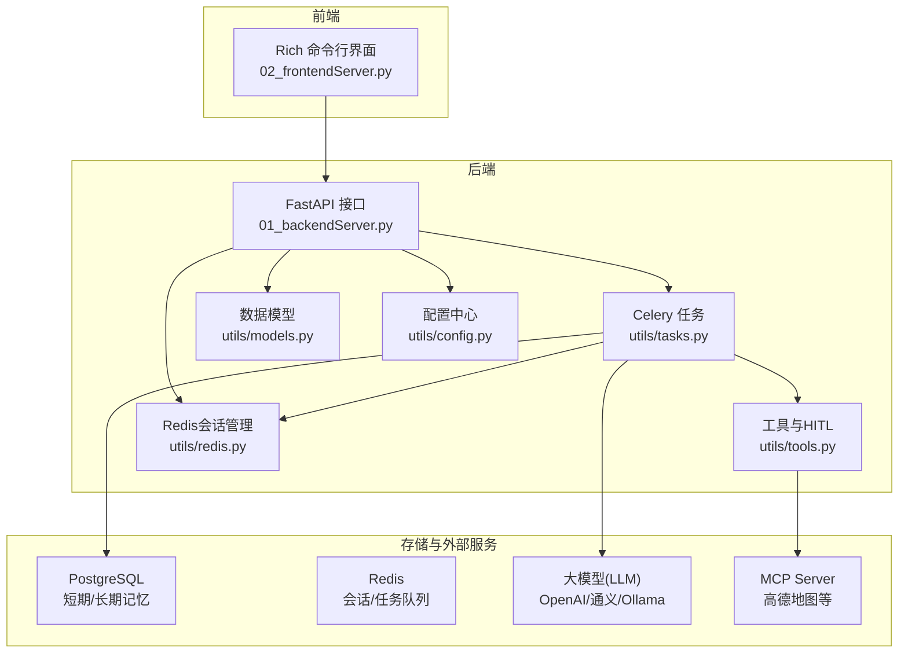
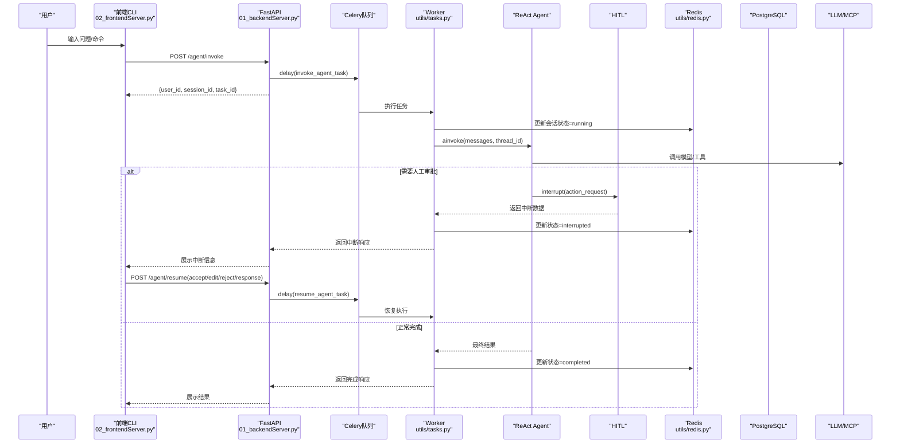
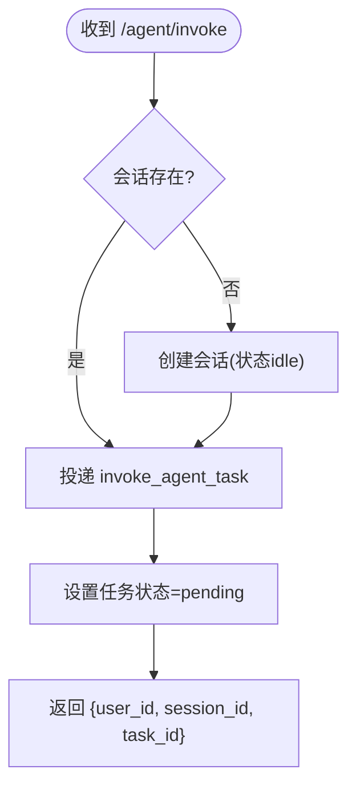
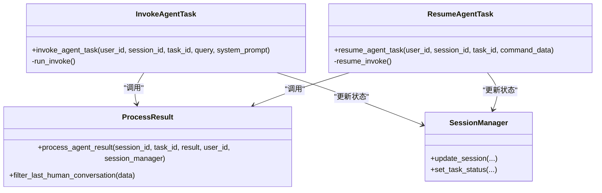
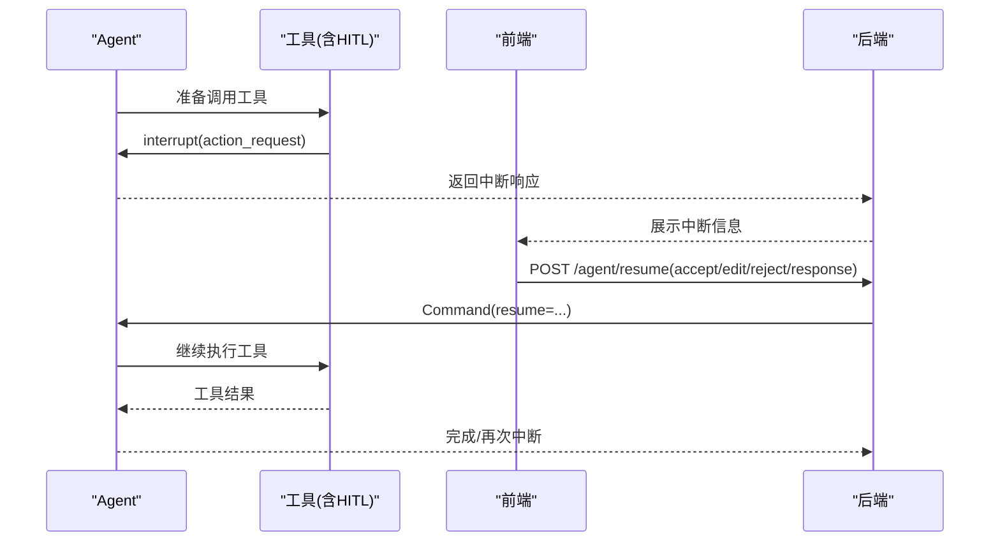
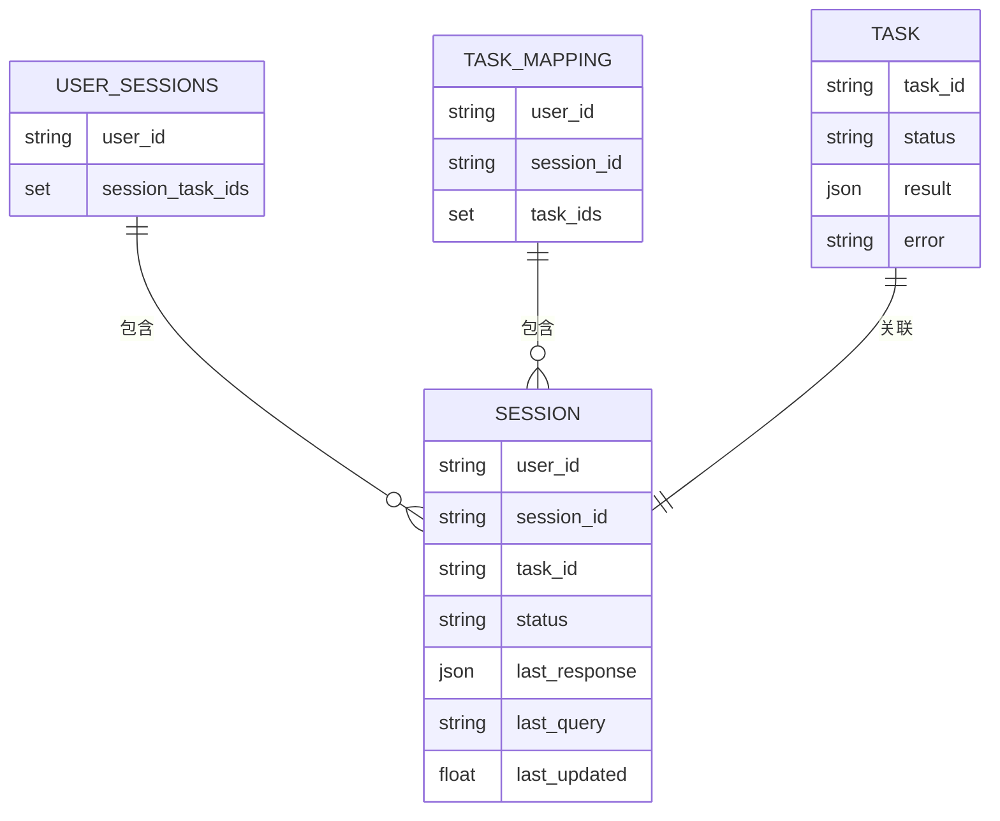
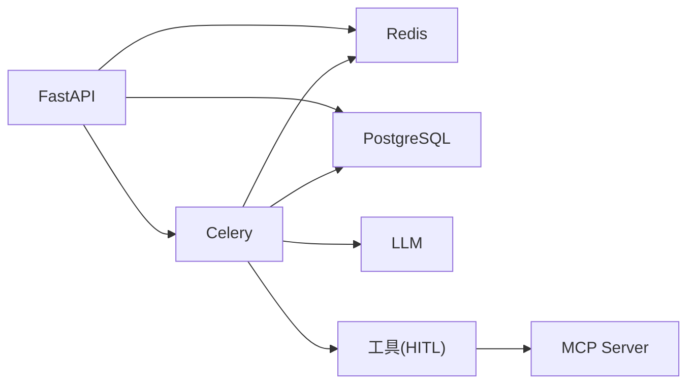

# 项目概述

<cite>
**本文引用的文件**
- [README.md](file://README.md)
- [01_backendServer.py](file://01_backendServer.py)
- [02_frontendServer.py](file://02_frontendServer.py)
- [utils/config.py](file://utils/config.py)
- [utils/tasks.py](file://utils/tasks.py)
- [utils/redis.py](file://utils/redis.py)
- [utils/models.py](file://utils/models.py)
- [utils/tools.py](file://utils/tools.py)
</cite>

## 目录
1. [引言](#引言)
2. [项目结构](#项目结构)
3. [核心组件](#核心组件)
4. [架构总览](#架构总览)
5. [详细组件分析](#详细组件分析)
6. [依赖关系分析](#依赖关系分析)
7. [性能与可扩展性](#性能与可扩展性)
8. [故障排查指南](#故障排查指南)
9. [结论](#结论)
10. [附录：使用示例与最佳实践](#附录使用示例与最佳实践)

## 引言
本项目是一个生产级 ReAct Agent 智能体服务，基于 LangGraph 的 ReAct 架构实现“思考-行动-观察”的智能体工作流，提供人机协作（HITL）机制、多会话管理、异步任务处理、短期与长期记忆持久化等能力。后端采用 FastAPI 暴露 REST API，前端通过 Rich 构建命令行交互界面，便于演示与联调。系统支持多厂商大模型接入（OpenAI、阿里通义千问、本地 Ollama 等），并通过 Redis 进行会话状态与任务队列管理，PostgreSQL 作为短期记忆 Checkpointer 与长期记忆 Store 的持久化存储。

该项目的核心价值在于：
- 以 ReAct 模式驱动工具调用与推理，具备可解释的执行路径
- 通过 HITL 对敏感或关键工具调用进行人工审批，保障安全可控
- 借助 Celery + Redis 实现高并发异步任务调度与故障恢复
- 结合 PostgreSQL 短期/长期记忆，支持上下文裁剪与用户偏好持久化
- 前后端解耦，便于扩展为 Web/移动端等多形态客户端

**章节来源**
- [README.md:1-39](file://README.md#L1-L39)

## 项目结构
项目采用分层与职责分离的组织方式：
- 入口层：后端 FastAPI 服务（01_backendServer.py）、前端 CLI 演示（02_frontendServer.py）
- 业务逻辑层：Celery 异步任务（utils/tasks.py）、工具与 HITL（utils/tools.py）
- 数据与配置层：Redis 会话管理（utils/redis.py）、Pydantic 数据模型（utils/models.py）、统一配置（utils/config.py）
- 基础设施：PostgreSQL（短期记忆 Checkpointer、长期记忆 Store）、Redis（会话与任务队列）、可选 MCP Server（如高德地图）

**图表来源**
- [01_backendServer.py:84-130](file://01_backendServer.py#L84-L130)
- [02_frontendServer.py:29-107](file://02_frontendServer.py#L29-L107)
- [utils/tasks.py:43-63](file://utils/tasks.py#L43-L63)
- [utils/tools.py:121-175](file://utils/tools.py#L121-L175)
- [utils/redis.py:37-103](file://utils/redis.py#L37-L103)
- [utils/config.py:4-34](file://utils/config.py#L4-L34)

**章节来源**
- [01_backendServer.py:1-424](file://01_backendServer.py#L1-L424)
- [02_frontendServer.py:1-860](file://02_frontendServer.py#L1-L860)
- [utils/tasks.py:1-564](file://utils/tasks.py#L1-L564)
- [utils/redis.py:1-493](file://utils/redis.py#L1-L493)
- [utils/models.py:1-97](file://utils/models.py#L1-L97)
- [utils/tools.py:1-175](file://utils/tools.py#L1-L175)
- [utils/config.py:1-34](file://utils/config.py#L1-L34)

## 核心组件
- ReAct Agent 执行引擎：基于 LangGraph 的 create_react_agent，集成工具调用、消息修剪、检查点与存储
- 人机协作（HITL）：通过 HumanInterruptConfig 与 interrupt 机制，在工具调用前请求人工批准/编辑/拒绝/直接反馈
- 多会话管理：Redis 维护 user_id -> session_id -> task_id 的多维映射，支持会话创建、更新、查询、删除与过期清理
- 异步任务处理：Celery 将 Agent 运行放入后台 Worker，立即返回 task_id，前端轮询或等待中断恢复
- 短期/长期记忆：PostgreSQL AsyncPostgresSaver 作为短期记忆 Checkpointer；AsyncPostgresStore 作为长期记忆存储，支持按用户命名空间读写
- 多厂商 LLM：通过统一接口获取不同厂商模型，灵活切换
- 工具生态：内置自定义工具（酒店预定、乘法计算）与 MCP Server 工具（如高德地图），全部可接入 HITL

**章节来源**
- [utils/tasks.py:318-451](file://utils/tasks.py#L318-L451)
- [utils/tasks.py:455-559](file://utils/tasks.py#L455-L559)
- [utils/tools.py:37-118](file://utils/tools.py#L37-L118)
- [utils/redis.py:37-103](file://utils/redis.py#L37-L103)
- [utils/config.py:13-34](file://utils/config.py#L13-L34)

## 架构总览
系统采用“前端 CLI + FastAPI 后端 + Celery Worker + 存储/LLM/MCP”的分层架构。前端发起请求后，后端快速入队并返回任务标识；Worker 执行 ReAct Agent，必要时触发 HITL 中断，由前端收集用户决策并恢复执行；结果与中间状态通过 Redis 持久化，短期/长期记忆落库 PostgreSQL。

**图表来源**
- [01_backendServer.py:132-173](file://01_backendServer.py#L132-L173)
- [01_backendServer.py:175-237](file://01_backendServer.py#L175-L237)
- [utils/tasks.py:318-451](file://utils/tasks.py#L318-L451)
- [utils/tasks.py:455-559](file://utils/tasks.py#L455-L559)
- [utils/redis.py:105-144](file://utils/redis.py#L105-L144)
- [utils/tools.py:37-118](file://utils/tools.py#L37-L118)

## 详细组件分析

### 后端 API（FastAPI）
- 生命周期管理：初始化 Redis 会话管理器、PostgreSQL 连接池、Checkpointer 与 Store
- 核心接口：
  - POST /agent/invoke：接收用户查询，创建/校验会话，投递 invoke_agent_task 到队列，立即返回 task_id
  - POST /agent/resume：根据中断类型恢复执行，投递 resume_agent_task
  - GET /system/info：系统会话统计
  - GET /agent/active/sessionid/{user_id}：最近活跃会话
  - GET /agent/sessionids/{user_id}：用户所有会话
  - GET /agent/tasks/{user_id}/{session_id}：会话下任务列表
  - GET /agent/status/{user_id}/{session_id}/{task_id}：任务状态详情
  - POST /agent/write/longterm：写入用户长期记忆
  - DELETE /agent/session/{user_id}/{session_id}：删除会话
  - DELETE /agent/task/{user_id}/{session_id}/{task_id}：删除任务

**图表来源**
- [01_backendServer.py:132-173](file://01_backendServer.py#L132-L173)

**章节来源**
- [01_backendServer.py:84-130](file://01_backendServer.py#L84-L130)
- [01_backendServer.py:132-414](file://01_backendServer.py#L132-L414)

### 异步任务与 ReAct Agent（Celery + LangGraph）
- invoke_agent_task：
  - 更新会话状态为 running，记录 last_query
  - 初始化数据库连接池、Checkpointer、Store、LLM、工具集
  - 读取用户长期记忆并拼接到 system_message
  - 构造 messages 并调用 agent.ainvoke，解析消息，处理结果（中断/完成/错误）
  - 过滤最近一次完整对话并更新任务状态
- resume_agent_task：
  - 使用 Command(resume=command_data) 恢复执行，流程同 invoke
- 结果处理：
  - process_agent_result 统一封装 AgentResponse，区分 interrupted/completed/error
  - filter_last_human_conversation 提取最近一次人类消息后的对话片段

**图表来源**
- [utils/tasks.py:318-451](file://utils/tasks.py#L318-L451)
- [utils/tasks.py:455-559](file://utils/tasks.py#L455-L559)
- [utils/tasks.py:194-264](file://utils/tasks.py#L194-L264)
- [utils/redis.py:105-144](file://utils/redis.py#L105-L144)

**章节来源**
- [utils/tasks.py:66-85](file://utils/tasks.py#L66-L85)
- [utils/tasks.py:87-134](file://utils/tasks.py#L87-L134)
- [utils/tasks.py:194-264](file://utils/tasks.py#L194-L264)
- [utils/tasks.py:318-451](file://utils/tasks.py#L318-L451)
- [utils/tasks.py:455-559](file://utils/tasks.py#L455-L559)

### 人机协作（HITL）
- add_human_in_the_loop：为任意工具包装成带中断能力的工具，调用前生成 HumanInterrupt，等待用户选择 accept/edit/reject/response
- 前端交互：当 Agent 返回 interrupted，前端展示中断信息并引导用户输入决策，再调用 /agent/resume 恢复执行

**图表来源**
- [utils/tools.py:37-118](file://utils/tools.py#L37-L118)
- [02_frontendServer.py:499-557](file://02_frontendServer.py#L499-L557)
- [01_backendServer.py:175-237](file://01_backendServer.py#L175-L237)

**章节来源**
- [utils/tools.py:37-118](file://utils/tools.py#L37-L118)
- [02_frontendServer.py:499-557](file://02_frontendServer.py#L499-L557)

### 多会话管理与Redis
- 数据结构：
  - session:{user_id}:{session_id}:{task_id}：会话状态与上下文
  - user_sessions:{user_id}：用户下的 session_id:task_id 集合
  - task_mapping:{user_id}:{session_id}：会话下的 task_id 集合
  - task:{task_id}：任务状态与结果
- 能力：
  - 创建/更新/查询/删除会话与任务
  - 自动清理过期键，保证一致性
  - 支持 TTL 动态调整与会话恢复

**图表来源**
- [utils/redis.py:56-103](file://utils/redis.py#L56-L103)
- [utils/redis.py:392-415](file://utils/redis.py#L392-L415)

**章节来源**
- [utils/redis.py:37-103](file://utils/redis.py#L37-L103)
- [utils/redis.py:146-244](file://utils/redis.py#L146-L244)
- [utils/redis.py:246-341](file://utils/redis.py#L246-L341)
- [utils/redis.py:343-493](file://utils/redis.py#L343-L493)

### 数据模型（Pydantic）
- AgentRequest：定义客户端调用 Agent 的请求体
- InterruptResponse：定义恢复执行的指令与参数
- AgentResponse：统一封装 Agent 执行结果（completed/interrupted/error）
- SystemInfoResponse/SessionInfoResponse/TaskInfoResponse/ActiveSessionInfoResponse/SessionStatusResponse：用于各接口的响应结构

**章节来源**
- [utils/models.py:6-97](file://utils/models.py#L6-L97)

### 工具与外部集成
- 自定义工具：book_hotel（模拟酒店预订）、multiply（乘法计算）
- MCP 工具：通过 MultiServerMCPClient 接入高德地图等外部服务
- 所有工具均可通过 add_human_in_the_loop 注入 HITL 能力

**章节来源**
- [utils/tools.py:121-175](file://utils/tools.py#L121-L175)
- [utils/tools.py:37-118](file://utils/tools.py#L37-L118)

## 依赖关系分析
- 后端依赖：
  - FastAPI/Uvicorn：HTTP 服务
  - Celery/Redis：异步任务与队列
  - LangGraph/LangChain：ReAct Agent、消息修剪、中断机制
  - psycopg_pool：PostgreSQL 异步连接池
  - Pydantic：数据模型校验
- 存储与外部服务：
  - PostgreSQL：短期记忆 Checkpointer、长期记忆 Store
  - Redis：会话状态、任务状态、队列
  - LLM：多厂商模型抽象
  - MCP Server：第三方工具服务

**图表来源**
- [01_backendServer.py:84-130](file://01_backendServer.py#L84-L130)
- [utils/tasks.py:43-63](file://utils/tasks.py#L43-L63)
- [utils/tools.py:121-175](file://utils/tools.py#L121-L175)
- [utils/config.py:13-34](file://utils/config.py#L13-L34)

**章节来源**
- [utils/config.py:4-34](file://utils/config.py#L4-L34)
- [utils/tasks.py:43-63](file://utils/tasks.py#L43-L63)
- [utils/tools.py:121-175](file://utils/tools.py#L121-L175)

## 性能与可扩展性
- 异步化：Celery Worker 承担 Agent 执行，避免阻塞 HTTP 线程，提升吞吐
- 连接池：psycopg_pool 管理数据库连接，减少握手开销
- 会话与任务 TTL：Redis 键过期策略降低内存占用，配合定期清理保持数据整洁
- 消息修剪：pre_model_hook 限制消息 token 数量，控制上下文长度，降低 LLM 成本
- 水平扩展：可通过增加 Worker 实例并行处理更多任务；Redis/PG 可独立扩容
- 工具扩展：新增工具只需注册并可选择性地接入 HITL；MCP 工具可热插拔

[本节为通用指导，不直接分析具体代码文件]

## 故障排查指南
- 常见错误定位：
  - 会话不存在：检查 Redis 中 user_sessions 与 task_mapping 是否有效，确认 TTL 与清理逻辑
  - 任务未更新：查看 Worker 日志与 Redis 任务状态键 task:{task_id}
  - 中断无法恢复：确认 /agent/resume 的 response_type 与 args 是否正确，检查会话状态是否为 interrupted
  - 数据库连接失败：验证 DB_URI、连接池参数与权限
  - LLM 调用失败：检查模型配置与网络代理
- 日志与调试：
  - 应用日志：logfile/app.log（轮转保留）
  - Worker 日志：Celery worker 输出级别设为 info/debug
  - 前端调试：Rich 控制台打印中断信息与状态变化

**章节来源**
- [01_backendServer.py:21-40](file://01_backendServer.py#L21-L40)
- [utils/tasks.py:21-40](file://utils/tasks.py#L21-L40)
- [utils/redis.py:246-341](file://utils/redis.py#L246-L341)
- [02_frontendServer.py:324-497](file://02_frontendServer.py#L324-L497)

## 结论
本项目以 ReAct 为核心，结合 HITL、多会话、异步任务与双记忆（短期/长期）机制，提供了可解释、可审计、可扩展的 AI Agent 服务能力。FastAPI 与 Rich 的组合使得开发与联调高效直观，适合在客服、助手、数据分析、工具编排等场景落地。通过合理的资源管理与扩展策略，可在生产环境中稳定运行并持续演进。

[本节为总结性内容，不直接分析具体代码文件]

## 附录：使用示例与最佳实践
- 启动顺序：
  - 启动 Celery Worker：celery -A 01_backendServer.celery_app worker --loglevel=info
  - 启动后端服务：python 01_backendServer.py
  - 启动前端演示：python 02_frontendServer.py
- 典型交互：
  - 输入用户 ID，系统自动恢复最近会话或新建会话
  - 发送问题，后端返回 task_id，前端轮询或等待中断
  - 遇到工具调用时，前端提示接受/拒绝/编辑参数或直接反馈
  - 完成后显示最终回答，支持历史会话恢复与新任务创建
- 最佳实践：
  - 合理设置 TTL 与消息修剪阈值，平衡上下文与成本
  - 对敏感工具启用 HITL，确保合规与安全
  - 监控 Redis 与 PostgreSQL 资源使用，及时扩容
  - 使用统一的 LLM 配置，便于切换与灰度发布

**章节来源**
- [README.md:187-193](file://README.md#L187-L193)
- [02_frontendServer.py:671-860](file://02_frontendServer.py#L671-L860)
- [utils/config.py:13-34](file://utils/config.py#L13-L34)